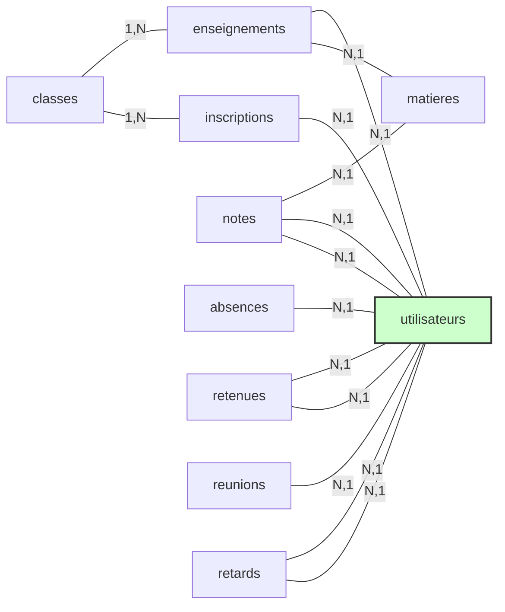

# 📁 Documentation technique de la base de données pour l’ERPGS “Ecolsystem”

---

Cette documentation décrit et explique la structure de la base de données pour notre logiciel de gestion : “ECOLSYSTEM”

---

## **1. Avant-propos**

> L'objectif principal de ce document est de présenter la mise en œuvre de la  base de données relationnelle  destinée à l’application de Gestion scolaire pour  l’établissement Le Bon Samaritain, situé au Cap Skirring. Ce projet vise à digitaliser les opérations administratives et pédagogiques en milieu rural, en utilisant des outils modernes pour garantir une efficacité optimale dans un environnement de ressources limitées.
> 

---

## 📚 Sommaire

1. Contexte général
2. Présentation et Structure de l’École
3. Objectifs du projet
4. Architecture de la base de données
    1. Description détaillée des tables
    2. Relations entre les tables
5. Conclusion

---

## **Contexte général**

Le projet répond à une problématique récurrente dans les zones rurales : le manque d'outils numériques adaptés à la gestion scolaire. L'ERP proposé vise à simplifier la gestion des élèves, des professeurs, des classes, et des opérations quotidiennes comme le suivi des absences, la gestion des emplois du temps et la tenue des bulletins.

---

## 2. Présentation et Structure de l’École "Le Bon Samaritain"

### 1. Contexte général

L'école *Le Bon Samaritain* est un établissement scolaire fraîchement implanté dans la région du Cap Skirring, en milieu rural. Son objectif est d’offrir une éducation de qualité malgré des ressources limitées, en adoptant une gestion modernisée grâce à un ERP sur mesure. L’établissement propose un enseignement à deux niveaux : **Seconde** et **Sixième**, pour un total de 137 élèves répartis en 4 classes.

### 2. Répartition des élèves

| **Niveau** | **Classe** | **Nombre d'élèves** |
| --- | --- | --- |
| Seconde | Seconde A | 31 |
| Seconde | Seconde B | 29 |
| Sixième | Sixième A | 39 |
| Sixième | Sixième B | 38 |

### 3. Personnel de l’établissement

<aside>
**Direction** : Monsieur *Lazare Ndiaye* (Proviseur).

</aside>

<aside>
**Professeurs** : 8 enseignants spécialisés couvrent les matières principales pour tous les niveaux.

<aside>
**Autres personnels** :

- *1 CPE* pour la discipline et le suivi des élèves.
- *1 comptable* pour la gestion financière.
- *1 informaticien* pour la maintenance et le support technique.
- *2 surveillants* pour encadrer les élèves en dehors des cours.
- *3 agents d'entretien*.
</aside>

</aside>

### 4. Infrastructure de l’établissement

L'école dispose de :

<aside>
**8 salles de classe**, adaptées pour accueillir chaque groupe d’élèves.

</aside>

<aside>
**4 bureaux** :

- Professeurs
- CPE
- Comptabilité
- Informatique
</aside>

<aside>
**2 box pour surveillants**.

</aside>

<aside>
**Laboratoire en construction**, dédié aux travaux pratiques scientifiques.

</aside>

### 5. Répartition des matières et professeurs

| **Matière** | **Professeurs** | **Niveaux enseignés** |
| --- | --- | --- |
| Mathématiques |  |  |
| Français |  |  |
| Histoire-Géographie |  |  |
| Sciences Physiques |  |  |
| Éducation Physique |  |  |
| Informatique |  |  |
| Anglais |  |  |
| Sciences de la Vie et Terre |  |  |

### 6. Gestion scolaire

- Les **élèves** sont **évalués dans toutes les matières** avec un **système de notes par matière** et **une moyenne générale calculée chaque trimestre**.
- Les **absences,** **retards et retenues** des élèves sont surveillés par le CPE, avec **des raisons documentées**.
- Les **professeurs** tiennent un **cahier de texte** indiquant les **contenus des cours pour chaque classe**.
- Les **parents** ont un rôle actif dans la vie scolaire, notamment pour **valider les paiements** et **participer à des réunions**.

---

## **3. Objectifs du projet**

- **Modernisation** : Digitaliser les processus administratifs et pédagogiques.
- **Centralisation des données** : Regrouper toutes les informations dans une base de données relationnelle.
- **Facilitation de la gestion** : Automatiser les tâches répétitives telles que la gestion des notes et le suivi des absences.
- **Scalabilité** : Créer une structure évolutive pouvant accueillir de nouvelles fonctionnalités.

---

## 4. Architecture de la base de données

### Vue d'ensemble

La base de données est structurée autour de **14 tables principales**, organisées en 3 **catégories** :

- **Tables des Acteurs** : `eleves`, `professeurs`, `utilisateurs`, `roles`
- **Tables de Structure** : `classes`, `salles`, `matieres`
- **Tables de Gestion** : `vie_scolaire`, `emploi_du_temps`, `cahier_de_texte`, `notes`, `paiements`, `reunions_parents`, `pointage`

### Schéma relationnel (Version Complète)


## Un “petit” soucis de “TAILLE” 📊

<aside>
Vous l’aurez remarqué : **Cette base de données est extrêmement large 😢 (plus 20 TABLES) !**

Un indésirable serais **la surexploitation de l’espace mémoire** qui rendrait notre application ERP **quasi inutilisable** du fait de **la lenteur des échanges** entre la base et les inputs (entrées) de l’utilisateur.

</aside>

## 💡Une Solution **⇒  Faire le ménage** 🧹**!**

<aside>
Dans le cadre de **l’implémentation en C++ de cet ERP**, nous allons donc **simplifier cette base de données** en réduisant de manière synthétique et simplifiée, de manière à réduire la consommation de l’espace mémoire, rendant notre application plus rapide et réactive .

En effet, **certaines tables peuvent facilement être regroupées en une seule**, réduisant ainsi **le cout d’utilisation** et **optimisant la manipulation** de notre application, nous permettant entre autres :

<aside>
**`⇒ d'éviter les bugs de lenteur et les délai de transmission entre le logiciel graphique et la base de données.`**

</aside>

**Dans la suite de cette documentation, nous vous présenterons donc :**

- **les tables de la base en version large (base complète) dans un premier temps,**
- **Puis la version optimisée et réduite (base applicative) que nous utiliserons dans le cadre de l’implémentation en C++.**
</aside>

---

## Description détaillée des tables :  La “Version Large”

### 3.1 Système d'authentification et gestion des utilisateurs

### Table `utilisateurs`

Gère tous les accès et informations communes des utilisateurs.

```sql
CREATE TABLE utilisateurs (
    id_utilisateur INT PRIMARY KEY AUTO_INCREMENT,
    nom VARCHAR(50) NOT NULL,
    prenom VARCHAR(50) NOT NULL,
    login VARCHAR(50) UNIQUE NOT NULL,
    mot_de_passe VARCHAR(255) NOT NULL,    
    email VARCHAR(100),
    type_utilisateur ENUM('eleve', 'professeur', 'parent', 'admin') NOT NULL,
    role_id INT,
    statut VARCHAR(10) DEFAULT 'actif',     -- actif/inactif
    derniere_connexion DATETIME,
    FOREIGN KEY (role_id) REFERENCES roles(id_role)
);

```

### Table `roles`

Définit les différents niveaux d'accès et permissions.

```sql
CREATE TABLE roles (
    id_role INT PRIMARY KEY AUTO_INCREMENT,
    nom_role VARCHAR(50) NOT NULL,
    description TEXT
);

```

### Table `eleves`

Informations spécifiques aux élèves.

```sql
CREATE TABLE eleves (
    id_eleve INT PRIMARY KEY AUTO_INCREMENT,
    utilisateur_id INT UNIQUE NOT NULL,
    classe_id INT,
    parent_id INT,
    date_naissance DATE NOT NULL,
    date_inscription DATE,
    FOREIGN KEY (utilisateur_id) REFERENCES utilisateurs(id_utilisateur),
    FOREIGN KEY (classe_id) REFERENCES classes(id_classe),
    FOREIGN KEY (parent_id) REFERENCES utilisateurs(id_utilisateur)
);

```

### Table `professeurs`

Informations spécifiques aux enseignants.

```sql
CREATE TABLE professeurs (
    id_professeur INT PRIMARY KEY AUTO_INCREMENT,
    utilisateur_id INT UNIQUE NOT NULL,
    matiere_principale_id INT,
    FOREIGN KEY (utilisateur_id) REFERENCES utilisateurs(id_utilisateur),
    FOREIGN KEY (matiere_principale_id) REFERENCES matieres(id_matiere)
);

```

### 3.2 Structure Académique

### Table `classes`

Organisation des groupes d'élèves.

```sql
CREATE TABLE classes (
    id_classe INT PRIMARY KEY AUTO_INCREMENT,
    nom_classe VARCHAR(50) NOT NULL,
    niveau VARCHAR(10) NOT NULL,           -- 'Sixième', 'Seconde'
    capacite INT NOT NULL,
    annee_scolaire VARCHAR(9) NOT NULL,    -- Format: '2023-2024'
    professeur_principal_id INT,           -- Lien vers le prof principal
    salle_principale_id INT,              
    FOREIGN KEY (professeur_principal_id) REFERENCES professeurs(id_professeur),
    FOREIGN KEY (salle_principale_id) REFERENCES salles(id_salle)
);

```

### Table `matieres`

Définition des matières enseignées.

```sql
CREATE TABLE matieres (
    id_matiere INT PRIMARY KEY AUTO_INCREMENT,
    nom_matiere VARCHAR(50) NOT NULL,
    coefficient INT NOT NULL,
    niveau VARCHAR(10) NOT NULL,           -- 'Sixième', 'Seconde', 'Tous'
    description_matière TEXT
);

```

### Table `professeur_matieres` (résultat relation MLD)

Association entre professeurs et matières enseignées.

```sql
CREATE TABLE professeur_matieres (
    id_prof_matiere INT PRIMARY KEY AUTO_INCREMENT,
    professeur_id INT,
    matiere_id INT,
    annee_scolaire VARCHAR(9),
    FOREIGN KEY (professeur_id) REFERENCES professeurs(id_professeur),
    FOREIGN KEY (matiere_id) REFERENCES matieres(id_matiere)
);

```

### Table `notes`

Gestion des notes (pour les élèves)

```sql
CREATE TABLE notes (
    id_note INT PRIMARY KEY AUTO_INCREMENT,
    eleve_id INT,
    matiere_id INT,
    professeur_id INT,
    note DECIMAL(4,2) NOT NULL,            -- Note sur 20
    coefficient INT NOT NULL,
    type_evaluation VARCHAR(20) NOT NULL,   -- 'devoir', 'examen', 'contrôle'
    date_evaluation DATE NOT NULL,
    commentaire TEXT,
    periode VARCHAR(20),                    -- 'Trimestre 1', etc.
    FOREIGN KEY (eleve_id) REFERENCES eleves(id_eleve),
    FOREIGN KEY (matiere_id) REFERENCES matieres(id_matiere),
    FOREIGN KEY (professeur_id) REFERENCES professeurs(id_professeur)
);

```

### 3.3 Gestion Administrative

### Table `salles`

Gestion des espaces physiques.

```sql
CREATE TABLE salles (
    id_salle INT PRIMARY KEY AUTO_INCREMENT,
    nom_salle VARCHAR(50) NOT NULL,
    type_salle VARCHAR(20) NOT NULL,       -- 'classe', 'laboratoire', 'bureau', ...
    capacite INT NOT NULL,
    equipements TEXT,
    statut VARCHAR(20) DEFAULT 'disponible',
    localisation VARCHAR(50)               -- Bâtiment/étage
);

```

### Table `emploi_du_temps`

Planification des cours.

```sql
CREATE TABLE emploi_du_temps (
    id_cours INT PRIMARY KEY AUTO_INCREMENT,
    classe_id INT,
    professeur_id INT,
    matiere_id INT,
    salle_id INT,
    jour_semaine VARCHAR(10) NOT NULL,     -- 'Lundi' à 'Vendredi'
    heure_debut TIME NOT NULL,
    heure_fin TIME NOT NULL,
    FOREIGN KEY (classe_id) REFERENCES classes(id_classe),
    FOREIGN KEY (professeur_id) REFERENCES professeurs(id_professeur),
    FOREIGN KEY (matiere_id) REFERENCES matieres(id_matiere),
    FOREIGN KEY (salle_id) REFERENCES salles(id_salle)
);

```

### Table `vie_scolaire`

Suivi des événements scolaires.

```sql
CREATE TABLE vie_scolaire (
    id_event INT PRIMARY KEY AUTO_INCREMENT,
    eleve_id INT,
    type_event VARCHAR(20) NOT NULL,       -- 'absence', 'retard', 'retenue'
    date_event DATE NOT NULL,
    heure_debut TIME,
    heure_fin TIME,
    motif TEXT,
    justifie BOOLEAN DEFAULT FALSE,
    createur_id INT,                       -- Qui a créé l'événement
    date_creation DATETIME DEFAULT CURRENT_TIMESTAMP,
    FOREIGN KEY (eleve_id) REFERENCES eleves(id_eleve),
    FOREIGN KEY (createur_id) REFERENCES utilisateurs(id_utilisateur)
);

```

### 3.4 Gestion Pédagogique

### Table `cahier_de_texte`

Suivi du contenu des cours et devoirs.

```sql
CREATE TABLE cahier_de_texte (
    id_cahier INT PRIMARY KEY AUTO_INCREMENT,
    professeur_id INT,
    classe_id INT,
    matiere_id INT,
    titre VARCHAR(100) NOT NULL,
    contenu TEXT NOT NULL,
    type_contenu VARCHAR(20) NOT NULL,      -- 'cours', 'devoir', 'document'
    date_creation DATETIME DEFAULT CURRENT_TIMESTAMP,
    date_limite DATE,                       -- Pour les devoirs
    fichier_joint VARCHAR(255),             -- Chemin vers le fichier
    createur_id INT,                        -- Lien vers l'utilisateur créateur
    FOREIGN KEY (professeur_id) REFERENCES professeurs(id_professeur),
    FOREIGN KEY (classe_id) REFERENCES classes(id_classe),
    FOREIGN KEY (matiere_id) REFERENCES matieres(id_matiere),
    FOREIGN KEY (createur_id) REFERENCES utilisateurs(id_utilisateur)
);

```

### Table `evaluations`

Gestion détaillée des évaluations (pour les classes et selon la matière)

```sql
CREATE TABLE evaluations (
    id_evaluation INT PRIMARY KEY AUTO_INCREMENT,
    matiere_id INT,
    classe_id INT,
    professeur_id INT,
    type_evaluation VARCHAR(20) NOT NULL,    -- 'contrôle', 'devoir', 'examen'
    date_evaluation DATE NOT NULL,
    duree INT,                               -- Durée en minutes
    coefficient INT DEFAULT 1,
    description TEXT,
    bareme DECIMAL(4,2),                     -- Note maximale possible
    FOREIGN KEY (matiere_id) REFERENCES matieres(id_matiere),
    FOREIGN KEY (classe_id) REFERENCES classes(id_classe),
    FOREIGN KEY (professeur_id) REFERENCES professeurs(id_professeur)
);

```

### 3.5 Gestion des Communications

### Table `reunions`

Organisation des rencontres parents-professeurs.

```sql
CREATE TABLE reunions_parents (
    id_reunion INT PRIMARY KEY AUTO_INCREMENT,
    date_reunion DATE NOT NULL,
    heure_debut TIME NOT NULL,
    heure_fin TIME NOT NULL,
    sujet VARCHAR(255) NOT NULL,
    description TEXT,
    statut VARCHAR(20) DEFAULT 'prévue',     -- 'prévue', 'tenue', 'annulée'
    classe_id INT,
    organisateur_id INT,                     -- Qui organise la réunion
    FOREIGN KEY (classe_id) REFERENCES classes(id_classe),
    FOREIGN KEY (organisateur_id) REFERENCES utilisateurs(id_utilisateur)
);

```

### Table `reunion_participants` (ne pas inclure)

Suivi des participations aux réunions.

```sql
CREATE TABLE reunion_participants (
    id_participation INT PRIMARY KEY AUTO_INCREMENT,
    reunion_id INT,
    utilisateur_id INT,
    statut_presence VARCHAR(20) DEFAULT 'absent',
    commentaire TEXT,
    date_reponse DATETIME,
    FOREIGN KEY (reunion_id) REFERENCES reunions_parents(id_reunion),
    FOREIGN KEY (utilisateur_id) REFERENCES utilisateurs(id_utilisateur)
);

```

### Table `messages`

Système de messagerie interne.

```sql
CREATE TABLE messages (
    id_message INT PRIMARY KEY AUTO_INCREMENT,
    expediteur_id INT,
    destinataire_id INT,
    sujet VARCHAR(255),
    contenu TEXT,
    date_envoi DATETIME DEFAULT CURRENT_TIMESTAMP,
    lu BOOLEAN DEFAULT FALSE,
    date_lecture DATETIME,
    importance VARCHAR(20) DEFAULT 'normal', -- 'normal', 'urgent', 'information'
    FOREIGN KEY (expediteur_id) REFERENCES utilisateurs(id_utilisateur),
    FOREIGN KEY (destinataire_id) REFERENCES utilisateurs(id_utilisateur)
);

```

### 3.6 Gestion Financière

### Table `paiements`

Suivi des transactions financières.

```sql
CREATE TABLE paiements (
    id_paiement INT PRIMARY KEY AUTO_INCREMENT,
    id_eleve INT,
    montant DECIMAL(10,2) NOT NULL,
    date_paiement DATE NOT NULL,
    mode_paiement ENUM('espèces', 'chèque', 'virement') NOT NULL,
    numero_reference VARCHAR(50),
    statut ENUM('en_attente', 'validé', 'rejeté') DEFAULT 'en_attente',
    commentaire TEXT,
    id_validateur INT,
    FOREIGN KEY (id_eleve) REFERENCES utilisateurs(id_utilisateur),
    FOREIGN KEY (id_validateur) REFERENCES utilisateurs(id_utilisateur)
);

```

### Table `factures`

```sql
CREATE TABLE factures (
    id_facture INT PRIMARY KEY AUTO_INCREMENT,
    id_eleve INT,
    montant_total DECIMAL(10,2) NOT NULL,
    date_emission DATE NOT NULL,
    date_echeance DATE NOT NULL,
    statut ENUM('en_attente', 'payée', 'retard') DEFAULT 'en_attente',
    type_facture ENUM('inscription', 'mensualité', 'autre') NOT NULL,
    description TEXT,
    FOREIGN KEY (id_eleve) REFERENCES utilisateurs(id_utilisateur)
);

```

### 3.7 Suivi et Contrôle

### Table `pointage` (principale également)

Gestion des entrées/sorties.

```sql
CREATE TABLE pointage (
    id_pointage INT PRIMARY KEY AUTO_INCREMENT,
    eleve_id INT,
    date_pointage DATE NOT NULL,
    heure_arrivee TIME,
    heure_depart TIME,
    statut VARCHAR(20) DEFAULT 'présent',    -- 'présent', 'absent', 'retard'
    commentaire TEXT,
    validateur_id INT,                       -- Qui a validé le pointage
    FOREIGN KEY (eleve_id) REFERENCES eleves(id_eleve),
    FOREIGN KEY (validateur_id) REFERENCES utilisateurs(id_utilisateur)
);

```

---

## Description détaillée des tables :  La “Version Simplifiée”

### Schéma relationnel (Version Optimisée)

Voici la version **réadaptée, schématisée, optimisée et structurée** de la base de notre ERP. 


Beaucoup Mieux, n’est-ce pas 😏? 

---

> Passons à l’implémentation dans le logiciel MySQL de nos tables avec le langage SQL :
> 

---

## 1. Création des Tables

### 1.1 Table `classes`

```sql
CREATE TABLE classes (
    id_classe INT PRIMARY KEY AUTO_INCREMENT,
    nom_classe VARCHAR(50) NOT NULL,
    niveau VARCHAR(20) NOT NULL,
    annee_scolaire VARCHAR(9) NOT NULL,
    professeur_principal INT,
    FOREIGN KEY (professeur_principal) REFERENCES utilisateurs(id_utilisateur)
);

```

### 1.2 Table `matieres`

```sql
CREATE TABLE matieres (
    id_matiere INT PRIMARY KEY AUTO_INCREMENT,
    nom VARCHAR(50) NOT NULL,
    description TEXT,
    coefficient INT DEFAULT 1,
    volume_horaire INT
);

```

### 1.3 Table `enseignements`

```sql
CREATE TABLE enseignements (
    id_enseignement INT PRIMARY KEY AUTO_INCREMENT,
    id_professeur INT,
    id_matiere INT,
    id_classe INT,
    FOREIGN KEY (id_professeur) REFERENCES utilisateurs(id_utilisateur),
    FOREIGN KEY (id_matiere) REFERENCES matieres(id_matiere),
    FOREIGN KEY (id_classe) REFERENCES classes(id_classe)
);

```

### 1.4 Table `inscriptions`

```sql
CREATE TABLE inscriptions (
    id_inscription INT PRIMARY KEY AUTO_INCREMENT,
    id_eleve INT,
    id_classe INT,
    date_inscription DATE DEFAULT '2024-12-01',
    statut ENUM('actif', 'inactif') DEFAULT 'actif',
    FOREIGN KEY (id_eleve) REFERENCES utilisateurs(id_utilisateur),
    FOREIGN KEY (id_classe) REFERENCES classes(id_classe)
);

```

### 1.5 Table `notes`

```sql
CREATE TABLE notes (
    id_note INT PRIMARY KEY AUTO_INCREMENT,
    id_eleve INT,
    id_matiere INT,
    id_professeur INT,
    note DECIMAL(4,2),
    coefficient INT DEFAULT 1,
    type_evaluation VARCHAR(50),
    date_evaluation DATE,
    commentaire TEXT,
    FOREIGN KEY (id_eleve) REFERENCES utilisateurs(id_utilisateur),
    FOREIGN KEY (id_matiere) REFERENCES matieres(id_matiere),
    FOREIGN KEY (id_professeur) REFERENCES utilisateurs(id_utilisateur)
);

```

### 1.6 Table `absences`

```sql
CREATE TABLE absences (
    id_absence INT PRIMARY KEY AUTO_INCREMENT,
    id_eleve INT,
    date_debut DATETIME,
    date_fin DATETIME,
    justifie BOOLEAN DEFAULT FALSE,
    motif TEXT,
    FOREIGN KEY (id_eleve) REFERENCES utilisateurs(id_utilisateur)
);

```

### 1.7 Table `pointage`

```sql
CREATE TABLE pointage (
    id_pointage INT PRIMARY KEY AUTO_INCREMENT,
    id_eleve INT,
    date_pointage DATE NOT NULL,
    heure_arrivee TIME,
    heure_depart TIME,
    statut VARCHAR(20) DEFAULT 'présent',
    commentaire TEXT,
    validateur_id INT,
    FOREIGN KEY (id_eleve) REFERENCES utilisateurs(id_utilisateur),
    FOREIGN KEY (validateur_id) REFERENCES utilisateurs(id_utilisateur)
);

```

### 1.8 Table `retenues`

```sql
CREATE TABLE retenues (
    id_retenue INT PRIMARY KEY AUTO_INCREMENT,
    id_eleve INT,
    date_retenue DATE NOT NULL,
    heure_debut TIME NOT NULL,
    heure_fin TIME NOT NULL,
    motif TEXT,
    id_professeur INT,
    statut ENUM('programmée', 'effectuée', 'annulée') DEFAULT 'programmée',
    commentaire TEXT,
    FOREIGN KEY (id_eleve) REFERENCES utilisateurs(id_utilisateur),
    FOREIGN KEY (id_professeur) REFERENCES utilisateurs(id_utilisateur)
);

```

### 1.9 Table `reunions`

```sql
CREATE TABLE reunions (
    id_reunion INT PRIMARY KEY AUTO_INCREMENT,
    titre VARCHAR(255) NOT NULL,
    date_reunion DATE NOT NULL,
    heure_debut TIME NOT NULL,
    heure_fin TIME NOT NULL,
    type_reunion ENUM('parents-professeurs', 'conseil_classe', 'administrative') NOT NULL,
    salle VARCHAR(50),
    description TEXT,
    organisateur_id INT,
    FOREIGN KEY (organisateur_id) REFERENCES utilisateurs(id_utilisateur)
);

```

### 1.10 Table `retards`

```sql
CREATE TABLE retards (
    id_retard INT PRIMARY KEY AUTO_INCREMENT,
    id_eleve INT,
    date_retard DATE NOT NULL,
    heure_arrivee TIME NOT NULL,
    duree_retard INT,
    justifie BOOLEAN DEFAULT FALSE,
    motif TEXT,
    id_validateur INT,
    FOREIGN KEY (id_eleve) REFERENCES utilisateurs(id_utilisateur),
    FOREIGN KEY (id_validateur) REFERENCES utilisateurs(id_utilisateur)
);

```

### 1.11 Table `paiements`

```sql
CREATE TABLE paiements (
    id_paiement INT PRIMARY KEY AUTO_INCREMENT,
    id_eleve INT,
    montant DECIMAL(10,2) NOT NULL,
    date_paiement DATE NOT NULL,
    mode_paiement ENUM('espèces', 'chèque', 'virement') NOT NULL,
    numero_reference VARCHAR(50),
    statut ENUM('en_attente', 'validé', 'rejeté') DEFAULT 'en_attente',
    commentaire TEXT,
    id_validateur INT,
    FOREIGN KEY (id_eleve) REFERENCES utilisateurs(id_utilisateur),
    FOREIGN KEY (id_validateur) REFERENCES utilisateurs(id_utilisateur)
);

```

### 1.12 Table `factures`

```sql
CREATE TABLE factures (
    id_facture INT PRIMARY KEY AUTO_INCREMENT,
    id_eleve INT,
    montant_total DECIMAL(10,2) NOT NULL,
    date_emission DATE NOT NULL,
    date_echeance DATE NOT NULL,
    statut ENUM('en_attente', 'payée', 'retard') DEFAULT 'en_attente',
    type_facture ENUM('inscription', 'mensualité', 'autre') NOT NULL,
    description TEXT,
    FOREIGN KEY (id_eleve) REFERENCES utilisateurs(id_utilisateur)
);

```

---

## Dictionnaire des Données

### Table `classes`

| Nom de la colonne | Type | Description |
| --- | --- | --- |
| `id_classe` | INT | Identifiant unique de la classe |
| `nom_classe` | VARCHAR(50) | Nom de la classe |
| `niveau` | VARCHAR(20) | Niveau de la classe (ex. "6ème", "2nde") |
| `annee_scolaire` | VARCHAR(9) | Année scolaire |
| `professeur_principal` | INT | Identifiant du professeur principal |

### Table `matieres`

| Nom de la colonne | Type | Description |
| --- | --- | --- |
| `id_matiere` | INT | Identifiant unique de la matière |
| `nom` | VARCHAR(50) | Nom de la matière |
| `description` | TEXT | Description de la matière |
| `coefficient` | INT | Coefficient de la matière |
| `volume_horaire` | INT | Volume horaire de la matière (en heures) |

### Table `enseignements`

| Nom de la colonne | Type | Description |
| --- | --- | --- |
| `id_enseignement` | INT | Identifiant unique de l'enseignement |
| `id_professeur` | INT | Identifiant du professeur |
| `id_matiere` | INT | Identifiant de la matière |
| `id_classe` | INT | Identifiant de la classe |

### Table `inscriptions`

| Nom de la colonne | Type | Description |
| --- | --- | --- |
| `id_inscription` | INT | Identifiant unique de l'inscription |
| `id_eleve` | INT | Identifiant de l'élève |
| `id_classe` | INT | Identifiant de la classe |
| `date_inscription` | DATE | Date d'inscription |
| `statut` | ENUM | Statut de l'élève (actif ou inactif) |

### Table `notes`

| Nom de la colonne | Type | Description |
| --- | --- | --- |
| `id_note` | INT | Identifiant unique de la note |
| `id_eleve` | INT | Identifiant de l'élève |
| `id_matiere` | INT | Identifiant de la matière |
| `id_professeur` | INT | Identifiant du professeur |
| `note` | DECIMAL(4,2) | Note obtenue |
| `coefficient` | INT | Coefficient appliqué |
| `type_evaluation` | VARCHAR(50) | Type de l'évaluation |
| `date_evaluation` | DATE | Date de l'évaluation |
| `commentaire` | TEXT | Commentaire sur la note |

### Table `absences`

| Nom de la colonne | Type | Description |
| --- | --- | --- |
| `id_absence` | INT | Identifiant unique de l'absence |
| `id_eleve` | INT | Identifiant de l'élève |
| `date_debut` | DATETIME | Date et heure de début de l'absence |
| `date_fin` | DATETIME | Date et heure de fin de l'absence |
| `justifie` | BOOLEAN | Absence justifiée ou non |
| `motif` | TEXT | Motif de l'absence |

### Table `retenues`

| Nom de la colonne | Type | Description |
| --- | --- | --- |
| `id_retenue` | INT | Identifiant unique de la retenue |
| `id_eleve` | INT | Identifiant de l'élève |
| `date_retenue` | DATE | Date de la retenue |
| `heure_debut` | TIME | Heure de début |
| `heure_fin` | TIME | Heure de fin |
| `motif` | TEXT | Motif de la retenue |
| `id_professeur` | INT | Identifiant du professeur qui a donné la retenue |
| `statut` | ENUM | Statut de la retenue (programmée, effectuée, annulée) |
| `commentaire` | TEXT | Commentaire sur la retenue |

### Table `reunions`

| Nom de la colonne | Type | Description |
| --- | --- | --- |
| `id_reunion` | INT | Identifiant unique de la réunion |
| `titre` | VARCHAR(255) | Titre de la réunion |
| `date_reunion` | DATE | Date de la réunion |
| `heure_debut` | TIME | Heure de début |
| `heure_fin` | TIME | Heure de fin |
| `type_reunion` | ENUM | Type de la réunion (parents-professeurs, conseil de classe, administrative) |
| `salle` | VARCHAR(50) | Salle de réunion |
| `description` | TEXT | Description de la réunion |
| `organisateur_id` | INT | Identifiant de l’organisateur |

### Table `retards`

| Nom de la colonne | Type | Description |
| --- | --- | --- |
| `id_retard` | INT | Identifiant unique du retard |
| `id_eleve` | INT | Identifiant de l'élève |
| `date_retard` | DATE | Date du retard |
| `heure_arrivee` | TIME | Heure d’arrivée |
| `duree_retard` | INT | Durée du retard (en minutes) |
| `justifie` | BOOLEAN | Retard justifié ou non |
| `motif` | TEXT | Motif du retard |
| `id_validateur` | INT | Identifiant du validateur du retard |

### Table `paiements`

| Nom de la colonne | Type | Description |
| --- | --- | --- |
| `id_paiement` | INT | Identifiant unique du paiement |
| `id_eleve` | INT | Identifiant de l'élève concerné |
| `montant` | DECIMAL(10,2) | Montant du paiement |
| `date_paiement` | DATE | Date du paiement |
| `mode_paiement` | ENUM | Mode de paiement (espèces, chèque, virement) |
| `numero_reference` | VARCHAR(50) | Numéro de référence du paiement |
| `statut` | ENUM | Statut du paiement (en_attente, validé, rejeté) |
| `commentaire` | TEXT | Commentaire sur le paiement |
| `id_validateur` | INT | Identifiant de l'utilisateur qui valide le paiement |

### Table `factures`

| Nom de la colonne | Type | Description |
| --- | --- | --- |
| `id_facture` | INT | Identifiant unique de la facture |
| `id_eleve` | INT | Identifiant de l'élève concerné |
| `montant_total` | DECIMAL(10,2) | Montant total de la facture |
| `date_emission` | DATE | Date d'émission de la facture |
| `date_echeance` | DATE | Date d'échéance du paiement |
| `statut` | ENUM | Statut de la facture (en_attente, payée, retard) |
| `type_facture` | ENUM | Type de facture (inscription, mensualité, autre) |
| `description` | TEXT | Description détaillée de la facture |

---

## Schématisation des Relations général



---

Ce schéma et dictionnaire permettent de mieux comprendre la structure et les relations entre les différentes entités de la base de données.