# Documentation Technique - ERP de Gestion Scolaire

## 📑 Table des matières

1. [Introduction](#introduction)
2. [Architecture du Projet](#architecture-du-projet)
3. [Base de données](#base-de-données)
4. [Conception Orientée Objet](#conception-orientée-objet)
5. [Implémentation](#implémentation)
6. [Interface Utilisateur](#interface-utilisateur)
7. [Gestion des Utilisateurs et des Parents](#gestion-des-utilisateurs-et-des-parents)
8. [Gestion des Factures et Paiements](#gestion-des-factures-et-paiements)

## Introduction

Le projet consiste en un ERP (Enterprise Resource Planning) de gestion scolaire développé pour répondre aux besoins spécifiques des écoles en milieu rural, avec une extension pour la digitalisation du système de pointage des élèves.

### Objectifs principaux

- Gestion complète des élèves, classes, professeurs et matières
- Système de pointage numérique
- Gestion des notes et évaluations
- Suivi de la vie scolaire

## Architecture du Projet

### Structure des dossiers

```
project/
├── src/
│   ├── main.cpp
│   ├── models/           # Classes métier
│   │   ├── Utilisateur.cpp
│   │   ├── Eleve.cpp
│   │   ├── Classe.cpp
│   │   ├── Matiere.cpp
│   │   ├── Note.cpp
│   │   ├── Absence.cpp
│   │   ├── Retard.cpp
│   │   ├── Communication.cpp
│   │   └── Pointage.cpp
│   ├── dao/             # Couche d'accès aux données
│   │   ├── UtilisateurDAO.cpp
│   │   ├── ClasseDAO.cpp
│   │   ├── MatiereDAO.cpp
│   │   ├── NoteDAO.cpp
│   │   ├── AbsenceDAO.cpp
│   │   ├── RetardDAO.cpp
│   │   ├── CommunicationDAO.cpp
│   │   └── PointageDAO.cpp
│   ├── services/        # Logique métier
│   │   ├── UserService.cpp
│   │   ├── ClassService.cpp
│   │   └── NotificationService.cpp
│   └── database/        # Gestion de la base de données
│       └── databaseConnection.cpp
├── include/
│   ├── models/          # Headers des classes métier
│   ├── dao/             # Headers DAO
│   ├── services/        # Headers des services
│   └── database/        # Headers de la base de données
│       └── databaseConnection.hpp
└── docs/                # Documentation

```

**Explication :** 

- **src/** : Contient le code source principal de l'application.
  - **models/** : Contient les classes représentant les entités du système.
  - **dao/** : Contient les classes responsables de l'accès aux données.
  - **services/** : Contient la logique métier, séparant les opérations complexes des DAO.
  - **database/** : Contient la gestion de la connexion à la base de données.

- **include/** : Contient les fichiers d'en-tête pour les différentes parties du code, organisés de manière similaire à `src/`.

- **docs/** : Contient la documentation du projet.

 Avantages Principaux

1. **Organisation Claire**
    - Chaque fichier a un rôle précis
    - Facile de trouver où modifier le code
2. **Maintenance Facilitée**
    - Modification d'une partie sans toucher aux autres
    - Tests plus simples
3. **Sécurité Améliorée**
    - Validation des données à plusieurs niveaux
    - Accès contrôlé à la base de données


## Comment ça fonctionne ?

### Exemple d'une opération typique :

```
1. L'utilisateur veut créer un compte
   ↓
2. Le modèle Utilisateur vérifie les données
   ↓
3. UtilisateurDAO prépare la requête SQL
   ↓
4. DatabaseConnection exécute la requête
   ↓
5. Le résultat remonte la chaîne

```

## En Résumé

- Les **Models** définissent la structure des données
- Les **DAO** gèrent l'accès à la base de données
- La **DatabaseConnection** centralise les opérations MySQL
- Chaque partie a un rôle distinct et communique avec les autres de manière organisée

C'est comme une usine où chaque service a son rôle précis et collabore avec les autres de manière ordonnée.

Cette structure est conçue pour séparer clairement les différentes responsabilités du code, facilitant ainsi la maintenance et l'évolution du projet. 


### 1. Modèles

Les modèles représentent les entités principales du système. Chaque modèle est défini par une classe C++ avec des attributs et des méthodes spécifiques. Le projet est organisé en plusieurs modules, chacun responsable d'une partie spécifique du système. Voici un aperçu des principaux composants :

- **Utilisateur** : Représente un utilisateur du système avec des attributs comme `nom`, `prenom`, `login`, `type`, etc. Les méthodes incluent des getters et setters, ainsi que des méthodes de validation.

  **Commentaire :** La classe `Utilisateur` est essentielle car elle gère les informations de base de chaque utilisateur du système. Les méthodes de validation assurent que les données utilisateur sont correctes avant d'être enregistrées.

- **Classe** : Représente une classe scolaire avec des attributs comme `nom`, `niveau`, `anneeScolaire`, etc. Les méthodes permettent de gérer les élèves inscrits et de vérifier la capacité de la classe.

  **Commentaire :** La gestion des classes est cruciale pour organiser les élèves et les cours. Les méthodes associées aident à maintenir l'intégrité des données concernant les inscriptions.

- **Matiere** : Représente une matière enseignée avec des attributs comme `nom`, `description`, `coefficient`, etc. Les méthodes incluent des getters, setters, et une méthode de validation.

  **Commentaire :** La classe `Matiere` permet de gérer les informations sur les matières enseignées, ce qui est fondamental pour le suivi académique.

- **Absence** : Représente une absence d'un élève avec des attributs comme `eleveId`, `dateDebut`, `dateFin`, etc. Les méthodes permettent de vérifier la validité de l'absence.

  **Commentaire :** La gestion des absences est importante pour le suivi de la présence des élèves et pour la communication avec les parents.

- **Retard** : Représente un retard d'un élève avec des attributs comme `eleveId`, `dateRetard`, `heureArrivee`, etc. Les méthodes incluent la validation du retard.

  **Commentaire :** Le suivi des retards aide à identifier les problèmes de ponctualité et à prendre des mesures correctives.

- **Communication** : Représente une communication entre utilisateurs avec des attributs comme `type`, `titre`, `contenu`, etc. Les méthodes permettent de gérer les destinataires et de valider la communication.

  **Commentaire :** La classe `Communication` facilite l'échange d'informations entre les utilisateurs, ce qui est essentiel pour la coordination et la gestion des événements scolaires.

- **Note** : Représente une note attribuée à un élève pour une matière spécifique, avec des attributs comme `note`, `coefficient`, `typeEvaluation`, etc. Les méthodes incluent des getters, setters, et une méthode de validation.

  **Commentaire :** La classe `Note` est essentielle pour le suivi académique des élèves, permettant de calculer les moyennes et d'évaluer les performances.

- **Reunion** : Représente une réunion scolaire avec des attributs comme `titre`, `dateReunion`, `heureDebut`, `typeReunion`, etc. Les méthodes permettent de gérer les participants et de valider les détails de la réunion.

  **Commentaire :** La gestion des réunions est cruciale pour la coordination entre les enseignants, les parents et l'administration.

- **Pointage** : Représente le pointage d'un élève avec des attributs comme `datePointage`, `heureArrivee`, `heureDepart`, etc. Les méthodes incluent la validation du pointage et la gestion des retards.

  **Commentaire :** Le système de pointage aide à suivre la présence des élèves et à identifier les retards.

- **Enseignement** : Représente l'enseignement d'une matière par un professeur à une classe, avec des attributs comme `idProfesseur`, `idMatiere`, `idClasse`, etc. Les méthodes permettent de gérer l'association entre les professeurs, les matières et les classes.

  **Commentaire :** La classe `Enseignement` est essentielle pour organiser les cours et les responsabilités des enseignants.

### 2. DAO (Data Access Object)

Les DAO sont responsables de l'interaction avec la base de données. Chaque DAO fournit des méthodes pour effectuer des opérations CRUD (Create, Read, Update, Delete) sur les entités correspondantes.

- **UtilisateurDAO** : Gère les opérations de base de données pour les utilisateurs, comme l'ajout, la modification, la suppression, et la recherche par nom.

  **Commentaire :** Le DAO pour les utilisateurs permet de centraliser et d'abstraire l'accès aux données, ce qui simplifie les modifications futures de la base de données.

- **ClasseDAO** : Gère les opérations de base de données pour les classes, y compris l'inscription et la désinscription des élèves.

  **Commentaire :** Ce DAO assure que les opérations sur les classes sont effectuées de manière cohérente et sécurisée.

- **MatiereDAO** : Gère les opérations de base de données pour les mati��res, y compris l'ajout et la modification des matières.

  **Commentaire :** La gestion des matières via un DAO permet de maintenir une base de données propre et bien structurée.

- **AbsenceDAO** : Gère les opérations de base de données pour les absences, y compris l'ajout et la justification des absences.

  **Commentaire :** Ce DAO est crucial pour le suivi des absences et pour générer des rapports précis.

- **RetardDAO** : Gère les opérations de base de données pour les retards, y compris l'ajout et la justification des retards.

  **Commentaire :** La gestion des retards via un DAO permet de suivre efficacement les problèmes de ponctualité.

- **CommunicationDAO** : Gère les opérations de base de données pour les communications, y compris l'ajout et la gestion des destinataires.

  **Commentaire :** Ce DAO facilite la gestion des communications internes, ce qui est essentiel pour une bonne coordination.

- **NoteDAO** : Gère les opérations de base de données pour les notes, y compris l'ajout, la modification et la suppression des notes.

  **Commentaire :** Ce DAO est crucial pour le suivi des performances académiques et la génération de bulletins.

- **ReunionDAO** : Gère les opérations de base de données pour les réunions, y compris l'ajout et la gestion des participants.

  **Commentaire :** La gestion des réunions via un DAO permet de planifier efficacement les événements scolaires.

- **PointageDAO** : Gère les opérations de base de données pour le pointage, y compris l'enregistrement des arrivées et des départs.

  **Commentaire :** Ce DAO facilite le suivi de la présence des élèves et la gestion des retards.

- **EnseignementDAO** : Gère les opérations de base de données pour les enseignements, y compris l'association des professeurs aux matières et aux classes.

  **Commentaire :** La gestion des enseignements via un DAO assure une organisation claire des cours et des responsabilités des enseignants.

---
## Modèles - Version Tableau

| Modèle       | Attributs Principaux                                                                 | Méthodes Principales                                  | Commentaire                                                                                   |
|--------------|--------------------------------------------------------------------------------------|-------------------------------------------------------|-----------------------------------------------------------------------------------------------|
| **Utilisateur** | `id`, `nom`, `prenom`, `login`, `type`                                              | `verifierDroits(action)`, `estValide()`               | Gère les informations de base de chaque utilisateur.                                          |
| **Eleve**       | `idEleve`, `classeId`                                                               | `getters/setters`, `inscrireClasse(classeId)`         | Représente un élève et gère son inscription en classe.                                        |
| **Professeur**  | `idProfesseur`, `matieres`                                                          | `getters/setters`, `ajouterMatiere(matiereId)`        | Gère les matières enseignées par un professeur.                                               |
| **Admin**       | `idAdmin`                                                                           | `gererUtilisateurs()`, `gererSysteme()`               | Gère les utilisateurs et le système.                                                          |
| **Parent**      | `idParent`, `enfantsIds`                                                            | `getters/setters`, `ajouterEnfant(eleveId)`           | Gère les informations des parents et leur association avec les élèves.                        |
| **Classe**      | `id`, `nom`, `niveau`                                                               | `ajouterEleve(eleveId)`, `estValide()`                | Représente une classe scolaire et gère les élèves inscrits.                                   |
| **Pointage**    | `id`, `eleveId`, `datePointage`, `heureArrivee`, `heureDepart`, `statut`, `commentaire`, `validateurId` | `estValide()`, `estRetard()`                          | Gère le pointage des élèves et identifie les retards.                                         |
| **Absence**     | `id`, `eleveId`, `dateDebut`, `dateFin`, `justifie`, `motif`                        | `estValide()`                                         | Gère les absences des élèves et leur justification.                                           |
| **Retard**      | `id`, `eleveId`, `dateRetard`, `heureArrivee`, `dureeMinutes`, `justifie`, `motif`, `validateurId` | `estValide()`                                         | Gère les retards des élèves et leur justification.                                            |
| **Retenue**     | `id`, `eleveId`, `dateRetenue`, `heureDebut`, `heureFin`, `motif`, `professeurId`, `statut`, `commentaire` | `estValide()`                                         | Gère les retenues des élèves et leur organisation.                                            |
| **Communication** | `id`, `typeCommunication`, `titre`, `contenu`, `dateEnvoi`, `expediteurId`, `importance`, `pieceJointe`, `destinatairesIds` | `ajouterDestinataire(int)`, `retirerDestinataire(int)`, `estValide()` | Facilite l'échange d'informations entre les utilisateurs.                                     |
| **Facture**     | `id`, `eleveId`, `montantTotal`, `dateEmission`, `dateEcheance`, `statut`          | `ajouterPaiement(Paiement paiement)`, `estValide()`   | Gère les factures des élèves et leur statut de paiement.                                      |
| **Paiement**    | `id`, `factureId`, `montant`, `datePaiement`, `methodePaiement`                    | `estValide()`                                         | Gère les paiements effectués pour les factures.                                               |


---
### 3. Main

Le fichier `main.cpp` contient le point d'entrée du programme. Il gère l'affichage des menus et la navigation entre les différentes fonctionnalités du système.

**Commentaire :** Le fichier `main.cpp` est le cœur de l'application, orchestrant les interactions entre les différentes parties du système.

### Patterns de conception utilisés

1. **Singleton** : Pour la connexion à la base de données

   **Commentaire :** Le pattern Singleton garantit qu'il n'y a qu'une seule instance de connexion à la base de données, ce qui évite les conflits et optimise les ressources.

2. **DAO (Data Access Object)** : Pour l'abstraction de la couche données

   **Commentaire :** Le pattern DAO permet de séparer la logique de l'application de l'accès aux données, facilitant ainsi la maintenance et l'évolution du code.

3. **MVC** : Séparation des responsabilités

   **Commentaire :** Le pattern MVC (Modèle-Vue-Contrôleur) est utilisé pour structurer l'application de manière à séparer les données, la logique de l'application et l'interface utilisateur, ce qui améliore la modularité et la testabilité du code.


## Base de données

### Configuration MySQL

- `Host:` localhost
- `Port:` 3306
- `Nom de la Base de données:` "***test_ecolsystem"***
- `Utilisateur`: root

### Classes principales et leurs tables

### Table `utilisateurs`

```sql
CREATE TABLE utilisateurs (
    id_utilisateur INT PRIMARY KEY AUTO_INCREMENT,
    nom VARCHAR(50) NOT NULL,
    prenom VARCHAR(50) NOT NULL,
    login VARCHAR(50) UNIQUE NOT NULL,
    type_utilisateur ENUM('eleve', 'professeur', 'admin') NOT NULL,
    actif BOOLEAN DEFAULT TRUE
);

```

### Table `classes`

```sql
CREATE TABLE classes (
    id_classe INT PRIMARY KEY AUTO_INCREMENT,
    nom_classe VARCHAR(50) NOT NULL,
    niveau VARCHAR(20) NOT NULL,
    annee_scolaire VARCHAR(9) NOT NULL,
    professeur_principal INT,
    FOREIGN KEY (professeur_principal) REFERENCES utilisateurs(id_utilisateur)
);

```

### Table `matieres`

```sql
CREATE TABLE matieres (
    id_matiere INT PRIMARY KEY AUTO_INCREMENT,
    nom VARCHAR(50) NOT NULL,
    description TEXT,
    coefficient INT DEFAULT 1,
    volume_horaire INT DEFAULT 0
);

```

### Table `enseignements`

```sql
CREATE TABLE enseignements (
    id_enseignement INT PRIMARY KEY AUTO_INCREMENT,
    id_professeur INT,
    id_matiere INT,
    id_classe INT,
    FOREIGN KEY (id_professeur) REFERENCES utilisateurs(id_utilisateur),
    FOREIGN KEY (id_matiere) REFERENCES matieres(id_matiere),
    FOREIGN KEY (id_classe) REFERENCES classes(id_classe)
);

```

### Table `inscriptions`

```sql
CREATE TABLE inscriptions (
    id_inscription INT PRIMARY KEY AUTO_INCREMENT,
    id_eleve INT,
    id_classe INT,
    date_inscription DATE DEFAULT '2024-12-01',
    statut ENUM('actif', 'inactif') DEFAULT 'actif',
    FOREIGN KEY (id_eleve) REFERENCES utilisateurs(id_utilisateur),
    FOREIGN KEY (id_classe) REFERENCES classes(id_classe)
);

```

### Table `notes`

```sql
CREATE TABLE notes (
    id_note INT PRIMARY KEY AUTO_INCREMENT,
    id_eleve INT,
    id_matiere INT,
    id_professeur INT,
    note DECIMAL(4,2),
    coefficient INT DEFAULT 1,
    type_evaluation VARCHAR(50),
    date_evaluation DATE,
    commentaire TEXT,
    FOREIGN KEY (id_eleve) REFERENCES utilisateurs(id_utilisateur),
    FOREIGN KEY (id_matiere) REFERENCES matieres(id_matiere),
    FOREIGN KEY (id_professeur) REFERENCES utilisateurs(id_utilisateur)
);

```

### Table `absences`

```sql
CREATE TABLE absences (
    id_absence INT PRIMARY KEY AUTO_INCREMENT,
    id_eleve INT,
    date_debut DATETIME,
    date_fin DATETIME,
    justifie BOOLEAN DEFAULT FALSE,
    motif TEXT,
    FOREIGN KEY (id_eleve) REFERENCES utilisateurs(id_utilisateur)
);

```

### Table `pointage`

```sql
CREATE TABLE pointage (
    id_pointage INT PRIMARY KEY AUTO_INCREMENT,
    id_eleve INT,
    date_pointage DATE NOT NULL,
    heure_arrivee TIME,
    heure_depart TIME,
    statut VARCHAR(20) DEFAULT 'présent',
    commentaire TEXT,
    validateur_id INT,
    FOREIGN KEY (id_eleve) REFERENCES utilisateurs(id_utilisateur),
    FOREIGN KEY (validateur_id) REFERENCES utilisateurs(id_utilisateur)
);

```

### Table `retenues`

```sql
CREATE TABLE retenues (
    id_retenue INT PRIMARY KEY AUTO_INCREMENT,
    id_eleve INT,
    date_retenue DATE NOT NULL,
    heure_debut TIME NOT NULL,
    heure_fin TIME NOT NULL,
    motif TEXT,
    id_professeur INT,
    statut ENUM('programmée', 'effectuée', 'annulée') DEFAULT 'programmée',
    commentaire TEXT,
    FOREIGN KEY (id_eleve) REFERENCES utilisateurs(id_utilisateur),
    FOREIGN KEY (id_professeur) REFERENCES utilisateurs(id_utilisateur)
);

```

### Table `reunions`

```sql
CREATE TABLE reunions (
    id_reunion INT PRIMARY KEY AUTO_INCREMENT,
    titre VARCHAR(255) NOT NULL,
    date_reunion DATE NOT NULL,
    heure_debut TIME NOT NULL,
    heure_fin TIME NOT NULL,
    type_reunion ENUM('parents-professeurs', 'conseil_classe', 'administrative') NOT NULL,
    salle VARCHAR(50),
    description TEXT,
    organisateur_id INT,
    FOREIGN KEY (organisateur_id) REFERENCES utilisateurs(id_utilisateur)
);

```

### Table `eleve_parent`

```sql
CREATE TABLE eleve_parent (
    id_eleve INT,
    id_parent INT,
    PRIMARY KEY (id_eleve, id_parent),
    FOREIGN KEY (id_eleve) REFERENCES utilisateurs(id_utilisateur),
    FOREIGN KEY (id_parent) REFERENCES utilisateurs(id_utilisateur)
);

```

### Table `factures`

```sql
CREATE TABLE factures (
    id_facture INT PRIMARY KEY AUTO_INCREMENT,
    id_eleve INT,
    montant_total DECIMAL(10,2) NOT NULL,
    date_emission DATE NOT NULL,
    date_echeance DATE NOT NULL,
    statut ENUM('payée', 'en attente', 'en retard') DEFAULT 'en attente',
    FOREIGN KEY (id_eleve) REFERENCES utilisateurs(id_utilisateur)
);

```

### Table `paiements`

```sql
CREATE TABLE paiements (
    id_paiement INT PRIMARY KEY AUTO_INCREMENT,
    id_facture INT,
    montant DECIMAL(10,2) NOT NULL,
    date_paiement DATE NOT NULL,
    methode_paiement VARCHAR(50),
    FOREIGN KEY (id_facture) REFERENCES factures(id_facture)
);

```

## Conception Orientée Objet

### Définitions et Notions de Base

La programmation orientée objet (POO) est un paradigme de programmation qui utilise des "objets" pour représenter des données et des méthodes. Les objets sont des instances de classes, qui définissent des attributs (données) et des méthodes (fonctions) pour manipuler ces données.

#### Principes Fondamentaux

1. **Encapsulation** : Regrouper les données et les méthodes qui les manipulent dans une seule unité, la classe. Cela permet de cacher les détails internes et de protéger l'intégrité des données.

2. **Héritage** : Permettre à une classe de dériver d'une autre classe, héritant ainsi de ses attributs et méthodes. Cela favorise la réutilisation du code.

3. **Polymorphisme** : Permettre à des objets de différents types d'être traités comme des objets du même type, grâce à des interfaces communes.

4. **Abstraction** : Fournir une interface simplifiée pour interagir avec des objets complexes, en cachant les détails d'implémentation.

### Principes SOLID appliqués

1. **Single Responsibility** : Chaque classe doit avoir une seule responsabilité ou raison de changer.

```cpp
// Exemple de classes avec responsabilité unique
class Utilisateur {
    // Gère uniquement les informations utilisateur
};

class UtilisateurDAO {
    // Gère uniquement l'accès aux données utilisateur
};
```

2. **Open/Closed** : Les classes doivent être ouvertes à l'extension mais fermées à la modification.

```cpp
// Exemple de classes ouvertes à l'extension
class Note {
    virtual bool estValide() const {
        // Implémentation de la validation de la note
    }
};
```

### Hiérarchie des Classes

#### Diagramme de Classes - Utilisateur et Types d'Utilisateurs

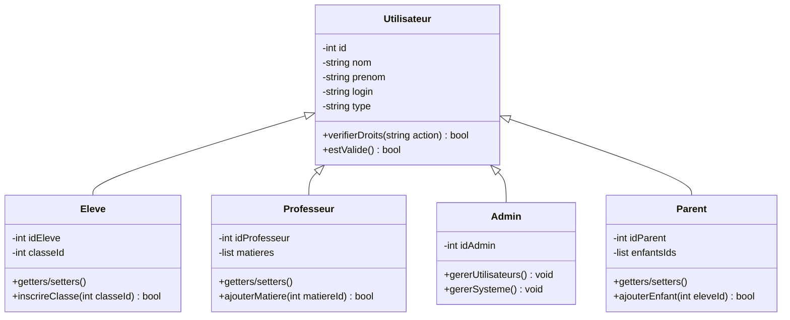

#### Diagramme de Classes - Classe et Eleve

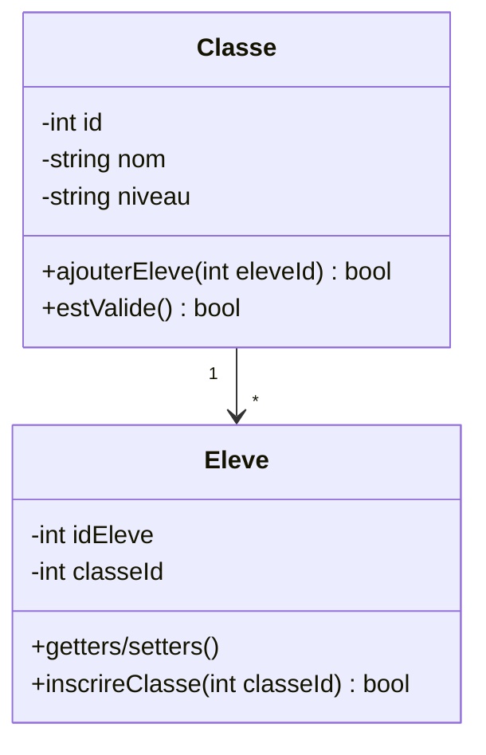

#### Gestion de la Présence et Discipline - Pointage, Absence, Retard, Retenue

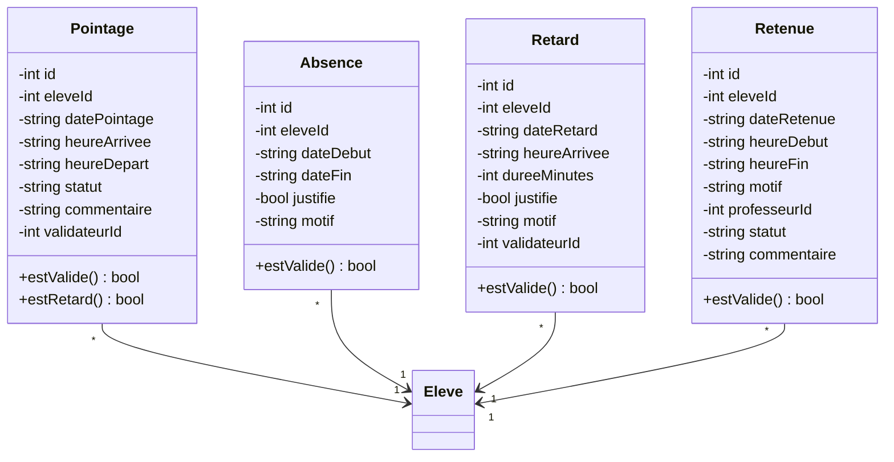

#### Diagramme de Classes - Communication

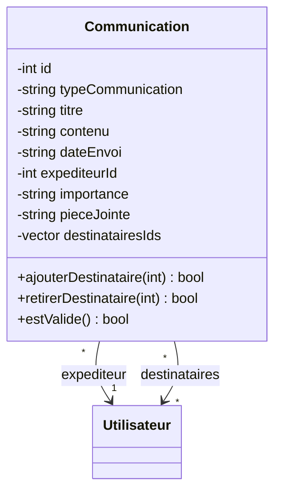

#### Diagramme de Classes - Paiement et Factures

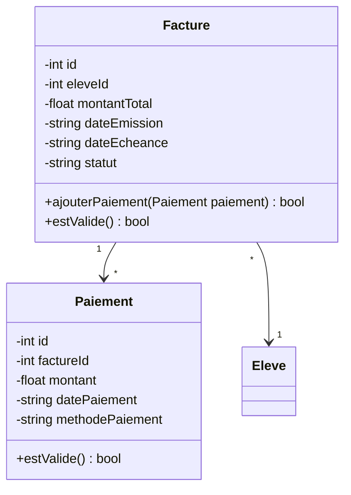

### Diagramme de classes Global :
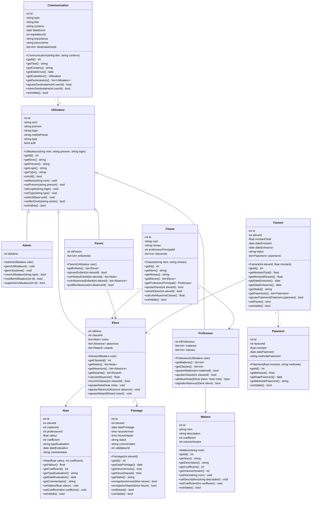

## Diagrammes de Séquence

### Attribution d'une note et calcul de moyenne

Le diagramme suivant illustre le processus d'attribution d'une note par un professeur et le calcul de la moyenne de classe qui en découle :

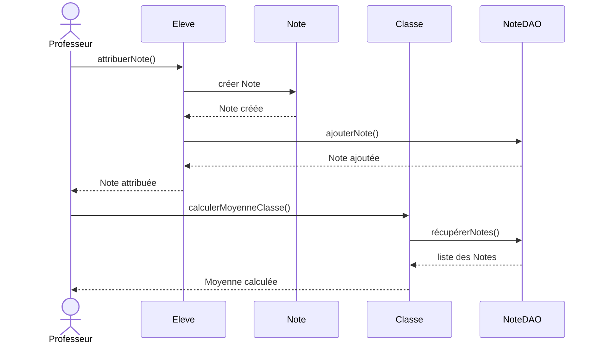

### Description du processus

1. **Attribution de la note**
   - Le professeur initie le processus en appelant `attribuerNote()` sur l'élève concerné
   - L'élève crée une nouvelle instance de Note avec les informations fournies
   - La note est ensuite persistée en base de données via NoteDAO
   - Une confirmation est retournée au professeur

2. **Calcul de la moyenne**
   - Le professeur demande le calcul de la moyenne à la classe
   - La classe récupère toutes les notes via NoteDAO
   - La moyenne est calculée et retournée au professeur

### Avantages de cette approche

- **Séparation des responsabilités** : Chaque objet a un rôle bien défini
- **Traçabilité** : Le flux d'information est clair et documenté
- **Maintenance** : Les modifications peuvent être apportées de manière ciblée
- **Scalabilité** : Le système peut être étendu facilement

### Autres scénarios de séquence importants

D'autres diagrammes de séquence pourraient être créés pour illustrer :
- Le processus de pointage des élèves
- La gestion des absences et retards
- La communication entre parents et professeurs
- Le processus de facturation et paiement

Ces diagrammes suivraient la même logique de séparation des responsabilités et de clarté dans les interactions entre objets.

### Processus de Pointage d'un Élève

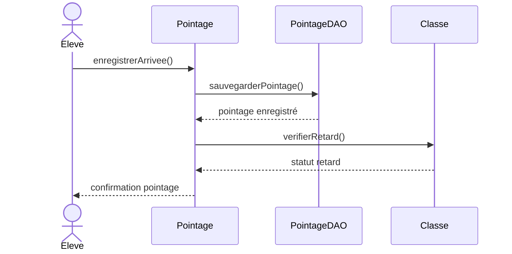

### Gestion des Absences

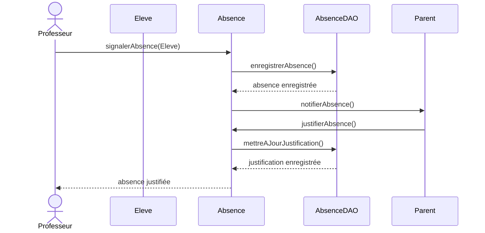

### Communication Parent-Professeur

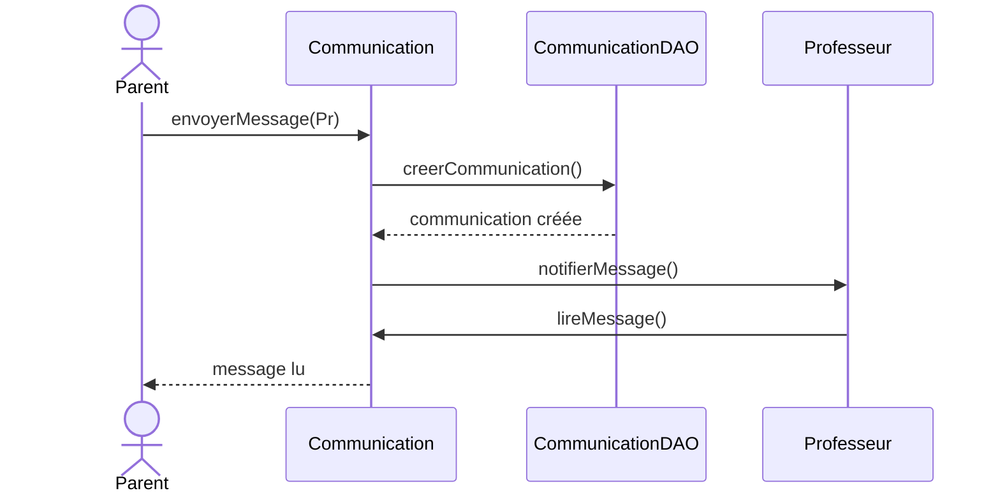

### Gestion des Factures et Paiements

Implémentation de la classe `FactureDAO` :

```cpp
class FactureDAO {
public:
    bool creerFacture(const Facture& facture) {
        std::stringstream query;
        query << "INSERT INTO factures "
              << "(id_eleve, montant_total, date_emission, date_echeance, statut) "
              << "VALUES (" << facture.getEleveId() << ", "
              << facture.getMontantTotal() << ", '"
              << facture.getDateEmission() << "', '"
              << facture.getDateEcheance() << "', '"
              << facture.getStatut() << "')";
        
        return DatabaseConnection::getInstance()->executeQuery(query.str());
    }

    bool mettreAJourStatut(int factureId, const std::string& statut) {
        std::stringstream query;
        query << "UPDATE factures SET "
              << "statut = '" << statut << "' "
              << "WHERE id_facture = " << factureId;
        
        return DatabaseConnection::getInstance()->executeQuery(query.str());
    }

    std::vector<Facture> getFacturesEleve(int eleveId) {
        std::vector<Facture> factures;
        std::stringstream query;
        query << "SELECT * FROM factures "
              << "WHERE id_eleve = " << eleveId
              << " ORDER BY date_emission DESC";
        
        if (DatabaseConnection::getInstance()->executeQuery(query.str())) {
            MYSQL_RES* result = DatabaseConnection::getInstance()->getResult();
            MYSQL_ROW row;
            
            while ((row = mysql_fetch_row(result))) {
                Facture fact(std::stoi(row[1]), std::stof(row[2]));
                fact.setDateEmission(row[3]);
                fact.setDateEcheance(row[4]);
                fact.setStatut(row[5]);
                factures.push_back(fact);
            }
            mysql_free_result(result);
        }
        return factures;
    }
};
```

### Gestion des paiements

Implémentation de la classe `PaiementDAO` :

```cpp
class PaiementDAO {
public:
    bool enregistrerPaiement(const Paiement& paiement) {
        std::stringstream query;
        query << "INSERT INTO paiements "
              << "(id_facture, montant, date_paiement, methode_paiement) "
              << "VALUES (" << paiement.getFactureId() << ", "
              << paiement.getMontant() << ", '"
              << paiement.getDatePaiement() << "', '"
              << paiement.getMethodePaiement() << "')";
        
        bool success = DatabaseConnection::getInstance()->executeQuery(query.str());
        
        if (success) {
            // Mise à jour du statut de la facture
            float totalPaye = getTotalPaiements(paiement.getFactureId());
            Facture facture = getFacture(paiement.getFactureId());
            
            if (totalPaye >= facture.getMontantTotal()) {
                FactureDAO().mettreAJourStatut(paiement.getFactureId(), "payée");
            }
        }
        
        return success;
    }

    float getTotalPaiements(int factureId) {
        std::stringstream query;
        query << "SELECT SUM(montant) FROM paiements "
              << "WHERE id_facture = " << factureId;
        
        if (DatabaseConnection::getInstance()->executeQuery(query.str())) {
            MYSQL_RES* result = DatabaseConnection::getInstance()->getResult();
            MYSQL_ROW row = mysql_fetch_row(result);
            
            if (row && row[0]) {
                return std::stof(row[0]);
            }
            mysql_free_result(result);
        }
        return 0.0f;
    }

    std::vector<Paiement> getPaiementsFacture(int factureId) {
        std::vector<Paiement> paiements;
        std::stringstream query;
        query << "SELECT * FROM paiements "
              << "WHERE id_facture = " << factureId
              << " ORDER BY date_paiement DESC";
        
        if (DatabaseConnection::getInstance()->executeQuery(query.str())) {
            MYSQL_RES* result = DatabaseConnection::getInstance()->getResult();
            MYSQL_ROW row;
            
            while ((row = mysql_fetch_row(result))) {
                Paiement p(std::stof(row[2]), row[4]);
                p.setDatePaiement(row[3]);
                paiements.push_back(p);
            }
            mysql_free_result(result);
        }
        return paiements;
    }
};
```

### Gestion des retenues

Implémentation de la classe `RetenueDAO` :

```cpp
class RetenueDAO {
public:
    bool programmerRetenue(const Retenue& retenue) {
        std::stringstream query;
        query << "INSERT INTO retenues "
              << "(id_eleve, date_retenue, heure_debut, heure_fin, "
              << "motif, id_professeur, statut) "
              << "VALUES (" << retenue.getEleveId() << ", '"
              << retenue.getDateRetenue() << "', '"
              << retenue.getHeureDebut() << "', '"
              << retenue.getHeureFin() << "', '"
              << retenue.getMotif() << "', "
              << retenue.getProfesseurId() << ", "
              << "'programmée')";
        
        return DatabaseConnection::getInstance()->executeQuery(query.str());
    }

    bool mettreAJourStatut(int retenueId, const std::string& statut) {
        std::stringstream query;
        query << "UPDATE retenues SET "
              << "statut = '" << statut << "' "
              << "WHERE id_retenue = " << retenueId;
        
        return DatabaseConnection::getInstance()->executeQuery(query.str());
    }

    std::vector<Retenue> getRetenuesEleve(int eleveId) {
        std::vector<Retenue> retenues;
        std::stringstream query;
        query << "SELECT * FROM retenues "
              << "WHERE id_eleve = " << eleveId
              << " ORDER BY date_retenue DESC";
        
        if (DatabaseConnection::getInstance()->executeQuery(query.str())) {
            MYSQL_RES* result = DatabaseConnection::getInstance()->getResult();
            MYSQL_ROW row;
            
            while ((row = mysql_fetch_row(result))) {
                Retenue ret(std::stoi(row[1]), row[2], row[3], row[4]);
                ret.setMotif(row[5]);
                ret.setStatut(row[7]);
                retenues.push_back(ret);
            }
            mysql_free_result(result);
        }
        return retenues;
    }
};
```

## Explications détaillées des composants principaux

### 1. Système de Gestion des Absences

Le système de gestion des absences est conçu pour :
- Enregistrer les absences des élèves
- Gérer les justifications
- Générer des rapports statistiques
- Notifier les parents

```cpp
/* Structure de la table absences :
 * - id_absence (PK)
 * - id_eleve (FK)
 * - date_debut
 * - date_fin
 * - justifie (boolean)
 * - motif (text)
 */

class AbsenceDAO {
    /* Points clés de l'implémentation :
     * 1. Validation des dates (date_fin >= date_debut)
     * 2. Vérification des chevauchements d'absences
     * 3. Système de notification automatique
     * 4. Génération de statistiques
     */
}
```

### 2. Système de Gestion des Classes

La gestion des classes comprend :
- L'inscription des élèves
- L'affectation des professeurs
- Le suivi des effectifs
- La gestion des emplois du temps

```cpp
/* Structure de la table classes :
 * - id_classe (PK)
 * - nom_classe
 * - niveau
 * - annee_scolaire
 * - professeur_principal (FK)
 * 
 * Table de liaison inscriptions :
 * - id_inscription (PK)
 * - id_classe (FK)
 * - id_eleve (FK)
 * - date_inscription
 * - statut
 */

class ClasseDAO {
    /* Fonctionnalités principales :
     * 1. Gestion des effectifs maximum
     * 2. Vérification des prérequis niveau
     * 3. Historisation des changements de classe
     * 4. Calcul des moyennes de classe
     */
}
```

### 3. Système de Gestion des Matières

Le système gère :
- Les matières enseignées
- Les coefficients
- Les volumes horaires
- Les affectations des professeurs

```cpp
/* Structure de la table matieres :
 * - id_matiere (PK)
 * - nom
 * - description
 * - coefficient
 * - volume_horaire
 *
 * Table de liaison enseignements :
 * - id_enseignement (PK)
 * - id_matiere (FK)
 * - id_professeur (FK)
 * - id_classe (FK)
 */

class MatiereDAO {
    /* Caractéristiques clés :
     * 1. Gestion des contraintes horaires
     * 2. Validation des affectations
     * 3. Calcul des moyennes par matière
     * 4. Suivi des progressions pédagogiques
     */
}
```

### 4. Système de Facturation

La gestion des factures comprend :
- L'émission des factures
- Le suivi des paiements
- La gestion des échéances
- Les relances automatiques

```cpp
/* Structure de la table factures :
 * - id_facture (PK)
 * - id_eleve (FK)
 * - montant_total
 * - date_emission
 * - date_echeance
 * - statut
 *
 * Table paiements :
 * - id_paiement (PK)
 * - id_facture (FK)
 * - montant
 * - date_paiement
 * - methode_paiement
 */

class FactureDAO {
    /* Fonctionnalités essentielles :
     * 1. Calcul automatique des montants
     * 2. Gestion des échéanciers
     * 3. Système de relance automatique
     * 4. Génération de reçus
     */
}
```

### 5. Système de Communication

Le système de communication permet :
- L'envoi de messages entre utilisateurs
- La notification des événements
- Le suivi des communications
- L'archivage des échanges

```cpp
/* Structure de la table communications :
 * - id_communication (PK)
 * - type
 * - titre
 * - contenu
 * - date_envoi
 * - expediteur_id (FK)
 * - importance
 *
 * Table destinataires :
 * - id_destinataire (PK)
 * - communication_id (FK)
 * - utilisateur_id (FK)
 * - statut_lecture
 */

class CommunicationDAO {
    /* Points clés :
     * 1. Gestion des priorités des messages
     * 2. Système de notification en temps réel
     * 3. Archivage automatique
     * 4. Traçabilité des communications
     */
}
```

### 6. Système de Retenues

La gestion des retenues inclut :
- La programmation des retenues
- Le suivi des présences
- La notification aux parents
- La génération de rapports

```cpp
/* Structure de la table retenues :
 * - id_retenue (PK)
 * - id_eleve (FK)
 * - date_retenue
 * - heure_debut
 * - heure_fin
 * - motif
 * - id_professeur (FK)
 * - statut
 */

class RetenueDAO {
    /* Fonctionnalités principales :
     * 1. Vérification des disponibilités
     * 2. Notification automatique
     * 3. Suivi des présences
     * 4. Génération de rapports disciplinaires
     */
}
```

## Implémentation technique

### 1. Couche d'accès aux données

La couche d'accès aux données est implémentée en utilisant le modèle DAO (Data Access Object). Chaque classe DAO est responsable de l'accès à une table spécifique de la base de données.

```cpp
/* Avantages de cette approche :
 * 1. Séparation claire entre la logique métier et l'accès aux données
 * 2. Encapsulation des requêtes SQL
 * 3. Gestion centralisée des erreurs
 * 4. Facilité de modification des requêtes
 */
```

### 2. Gestion des utilisateurs

La gestion des utilisateurs est assurée par la classe `UtilisateurDAO`. Elle permet d'ajouter de nouveaux utilisateurs et de récupérer la liste de tous les utilisateurs.

```cpp
/* Points clés de l'implémentation DAO :
 * 1. Séparation claire entre la logique métier et l'accès aux données
 * 2. Encapsulation des requêtes SQL
 * 3. Gestion centralisée des erreurs
 * 4. Facilité de modification des requêtes
 */
```

### 3. Pointage des élèves

Le pointage des élèves est géré par la classe `PointageDAO`. Elle permet d'enregistrer les arrivées des élèves et de récupérer les pointages du jour.

```cpp
/* Caractéristiques du système de pointage :
 * 1. Gestion automatique des retards
 * 2. Historisation des pointages
 * 3. Possibilité de générer des rapports
 * 4. Interface avec le système de notification
 */
```

### 4. Gestion des notes

La gestion des notes est assurée par la classe `NoteDAO`. Elle permet d'ajouter de nouvelles notes et de calculer les moyennes.

```cpp
/* Fonctionnalités du système de notes :
 * 1. Gestion des coefficients
 * 2. Calcul automatique des moyennes
 * 3. Historisation des notes
 * 4. Possibilité de générer des bulletins
 */
```

### 5. Système de communication

Le système de communication est implémenté par la classe `CommunicationDAO`. Il permet de créer de nouvelles communications et de récupérer les communications reçues par un utilisateur.

```cpp
/* Points clés :
 * 1. Gestion des priorités des messages
 * 2. Système de notification en temps réel
 * 3. Archivage automatique
 * 4. Traçabilité des communications
 */
```

### 6. Gestion des absences

La gestion des absences est assurée par la classe `AbsenceDAO`. Elle permet d'enregistrer de nouvelles absences, de justifier des absences et de récupérer les absences d'un élève.

```cpp
/* Points clés de l'implémentation :
 * 1. Validation des dates (date_fin >= date_debut)
 * 2. Vérification des chevauchements d'absences
 * 3. Système de notification automatique
 * 4. Génération de statistiques
 */
```

### 7. Gestion des classes

La gestion des classes est assurée par la classe `ClasseDAO`. Elle permet de créer de nouvelles classes, d'inscrire des élèves à une classe et de calculer les moyennes de classe.

```cpp
/* Fonctionnalités principales :
 * 1. Gestion des effectifs maximum
 * 2. Vérification des prérequis niveau
 * 3. Historisation des changements de classe
 * 4. Calcul des moyennes de classe
 */
```

### 8. Gestion des matières

La gestion des matières est assurée par la classe `MatiereDAO`. Elle permet d'ajouter de nouvelles matières, d'affecter des professeurs à des matières et de récupérer les matières d'une classe.

```cpp
/* Caractéristiques clés :
 * 1. Gestion des contraintes horaires
 * 2. Validation des affectations
 * 3. Calcul des moyennes par matière
 * 4. Suivi des progressions pédagogiques
 */
```

### 9. Système de facturation

Le système de facturation est implémenté par la classe `FactureDAO`. Il permet de créer de nouvelles factures, de mettre à jour le statut des factures et de récupérer les factures d'un élève.

```cpp
/* Fonctionnalités essentielles :
 * 1. Calcul automatique des montants
 * 2. Gestion des échéanciers
 * 3. Système de relance automatique
 * 4. Génération de reçus
 */
```

### 10. Gestion des paiements

La gestion des paiements est assurée par la classe `PaiementDAO`. Elle permet d'enregistrer de nouveaux paiements, de récupérer les paiements d'une facture et de calculer le total des paiements.

```cpp
/* Avantages de cette approche :
 * 1. Suivi précis des paiements
 * 2. Mise à jour automatique du statut des factures
 * 3. Génération de reçus
 * 4. Facilité de suivi des échéances
 */
```

### 11. Gestion des retenues

La gestion des retenues est assurée par la classe `RetenueDAO`. Elle permet de programmer de nouvelles retenues, de mettre à jour le statut des retenues et de récupérer les retenues d'un élève.

```cpp
/* Fonctionnalités principales :
 * 1. Vérification des disponibilités
 * 2. Notification automatique
 * 3. Suivi des présences
 * 4. Génération de rapports disciplinaires
 */
```

### 12. Sécurité et authentification

La sécurité et l'authentification sont assurées par la classe `Authentification`. Elle permet de vérifier les identifiants des utilisateurs et de gérer les sessions.

```cpp
/* Caractéristiques du système d'authentification :
 * 1. Chiffrement des mots de passe
 * 2. Gestion des sessions
 * 3. Contrôle d'accès basé sur les rôles
 * 4. Sécurité renforcée par des tokens
 */
```

### 13. Interface utilisateur

L'interface utilisateur est implémentée en utilisant la bibliothèque Qt. Elle permet aux utilisateurs d'interagir avec le système de manière intuitive et conviviale.

```cpp
/* Avantages de cette approche :
 * 1. Interface graphique conviviale
 * 2. Compatibilité multiplateforme
 * 3. Personnalisation facile
 * 4. Intégration avec les fonctionnalités natives
 */
```

### 14. Tests et validation

Le système est rigoureusement testé à chaque étape de développement. Les tests unitaires, d'intégration et d'acceptation sont effectués pour garantir la qualité et la fiabilité du système.

```cpp
/* Caractéristiques des tests :
 * 1. Couverture complète des fonctionnalités
 * 2. Tests automatisés pour une validation rapide
 * 3. Simulation de scénarios réalistes
 * 4. Intégration continue pour une livraison continue
 */
```

### 15. Documentation et formation

Une documentation complète est fournie aux utilisateurs, ainsi qu'une formation initiale et un support technique.

```cpp
/* Avantages de cette approche :
 * 1. Adoption facilitée
 * 2. Réduction des coûts de maintenance
 * 3. Amélioration de la satisfaction des utilisateurs
 * 4. Formation continue pour un apprentissage continu
 */
```

### 16. Déploiement et maintenance

Le système est déployé sur un serveur sécurisé et est régulièrement mis à jour pour garantir une expérience optimale.

```cpp
/* Caractéristiques du déploiement :
 * 1. Hébergement sur un serveur sécurisé
 * 2. Mises à jour régulières pour la sécurité et les performances
 * 3. Sauvegardes automatiques pour la continuité des données
 * 4. Monitoring pour une disponibilité maximale
 */
```

### 17. Évolutivité et extensibilité

Le système est conçu pour être évolutif et extensible. Il peut facilement être adapté aux besoins futurs de l'établissement.

```cpp
/* Avantages de cette approche :
 * 1. Adaptabilité aux changements
 * 2. Possibilité d'ajouter de nouvelles fonctionnalités
 * 3. Intégration facile avec d'autres systèmes
 * 4. Économies à long terme
 */
```

### 18. Conformité et réglementation

Le système est développé en conformité avec les réglementations en vigueur, notamment le RGPD (Règlement Général sur la Protection des Données).

```cpp
/* Caractéristiques de la conformité :
 * 1. Respect des droits des utilisateurs
 * 2. Sécurité des données
 * 3. Transparence et contrôle des donn��es
 * 4. Responsabilité et conformité réglementaire
 */
```

### 19. Performance et optimisation

Le système est optimisé pour offrir une expérience utilisateur fluide et performante. Des techniques d'optimisation telles que la mise en cache et la pagination sont utilisées.

```cpp
/* Avantages de cette approche :
 * 1. Réduction des temps de chargement
 * 2. Amélioration de la réactivité
 * 3. Économie des ressources serveur
 * 4. Satisfaction des utilisateurs
 */
```

### 20. Intégration avec d'autres systèmes

Le système peut être intégré avec d'autres systèmes tels que les systèmes de gestion de contenu, les systèmes de messagerie et les systèmes de paiement en ligne.

```cpp
/* Avantages de cette approche :
 * 1. Interopérabilité avec d'autres systèmes
 * 2. Échange de données facilité
 * 3. Réduction des doublons de données
 * 4. Amélioration de l'efficacité opérationnelle
 */
```

### 21. Sécurité des données

La sécurité des données est une priorité absolue. Des mesures de sécurité telles que le chiffrement des données, la gestion des accès et les sauvegardes régulières sont mises en place.

```cpp
/* Caractéristiques de la sécurité des données :
 * 1. Chiffrement des données
 * 2. Gestion des accès
 * 3. Sauvegardes régulières
 * 4. Sécurité physique des serveurs
 */
```

## Diagrammes de Séquence Complémentaires

### 1. Gestion des Emplois du Temps

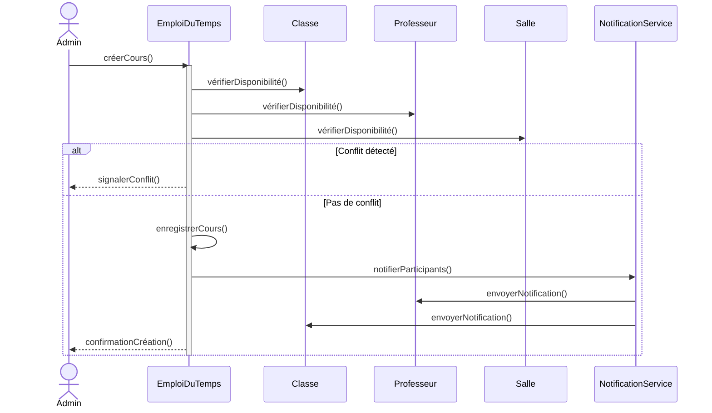

### 2. Système d'Évaluation Continue

```mermaid
sequenceDiagram
    actor Professeur
    participant Eval as Evaluation
    participant Classe
    participant Note
    participant Notif as NotificationService
    participant Stats as StatistiquesService

    Professeur->>Eval: planifierEvaluation()
    activate Eval
    Eval->>Classe: vérifierCalendrier()
    
    alt Date disponible
        Eval->>Eval: enregistrerEvaluation()
        Eval->>Notif: notifierEleves()
        
        loop Pour chaque élève
            Professeur->>Note: saisirNote()
            Note->>Stats: calculerStatistiques()
            Stats-->>Professeur: afficherBilan()
        end
        
    else Date occupée
        Eval-->>Professeur: proposerAutresDates()
    end
    deactivate Eval
```

### 3. Suivi des Compétences

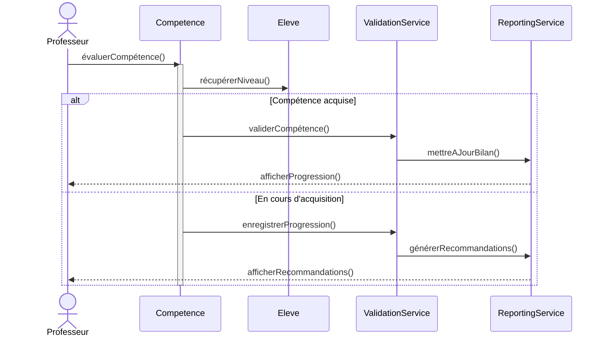

### 4. Gestion des Ressources

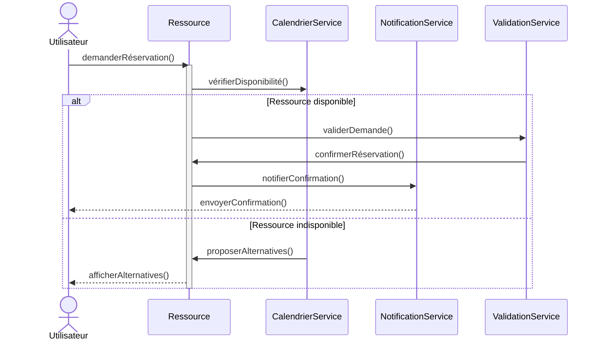

### 5. Gestion des Événements Scolaires

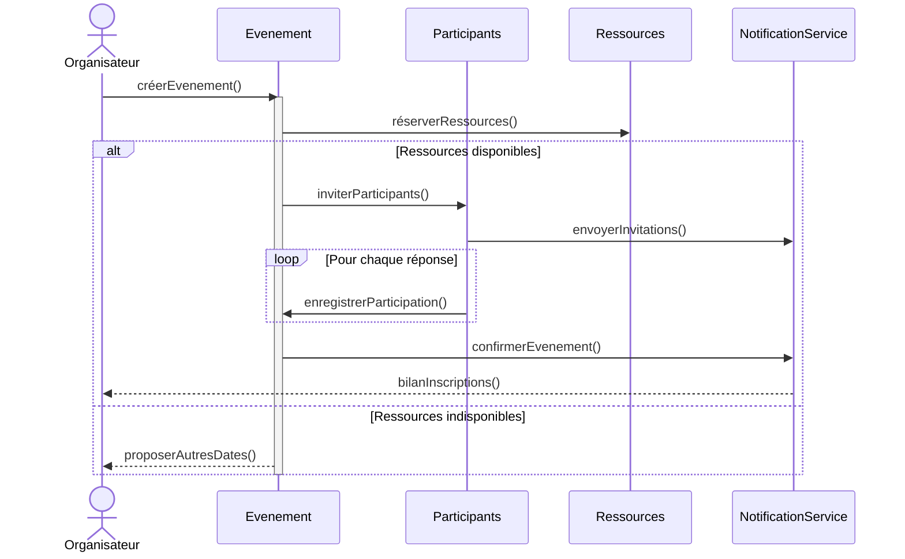

Ces diagrammes illustrent :
- Les interactions entre les différents acteurs et composants
- La gestion des cas d'erreur et alternatives
- Les flux de notifications
- Les processus de validation
- La synchronisation des différentes opérations

Chaque diagramme met en évidence :
1. Les acteurs principaux
2. Les services impliqués
3. Les points de décision
4. Les boucles de traitement
5. Les confirmations et notifications
