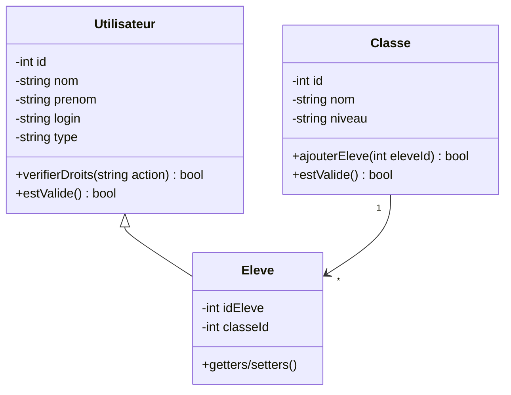
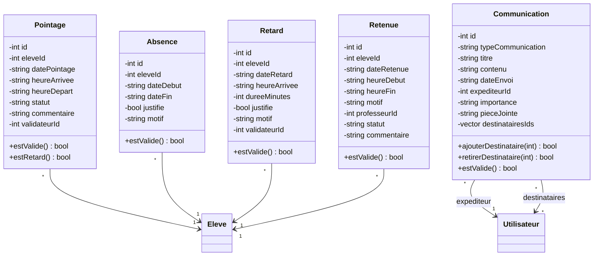

# Documentation Technique - ERP de Gestion Scolaire

## 📑 Table des matières

1. [Introduction](https://www.notion.so/Documentation-Technique-ERP-de-Gestion-Scolaire-14b95ef1091780408795cc9c0a67d328?pvs=21)
2. [Architecture du Projet](https://www.notion.so/Documentation-Technique-ERP-de-Gestion-Scolaire-14b95ef1091780408795cc9c0a67d328?pvs=21)
3. [Base de données](https://www.notion.so/Documentation-Technique-ERP-de-Gestion-Scolaire-14b95ef1091780408795cc9c0a67d328?pvs=21)
4. [Conception Orientée Objet](https://www.notion.so/Documentation-Technique-ERP-de-Gestion-Scolaire-14b95ef1091780408795cc9c0a67d328?pvs=21)
5. [Implémentation](https://www.notion.so/Documentation-Technique-ERP-de-Gestion-Scolaire-14b95ef1091780408795cc9c0a67d328?pvs=21)
6. [Interface Utilisateur](https://www.notion.so/Documentation-Technique-ERP-de-Gestion-Scolaire-14b95ef1091780408795cc9c0a67d328?pvs=21)

## Introduction

Le projet consiste en un ERP (Enterprise Resource Planning) de gestion scolaire développé pour répondre aux besoins spécifiques des écoles en milieu rural, avec une extension pour la digitalisation du système de pointage des élèves.

### Objectifs principaux

- Gestion complète des élèves, classes, professeurs et matières
- Système de pointage numérique
- Gestion des notes et évaluations
- Suivi de la vie scolaire

## Architecture

### Structure des dossiers

```
project/
├── src/
│   ├── main.cpp
│   ├── models/           # Classes métier
│   │   ├── Utilisateur.cpp
│   │   ├── Eleve.cpp
│   │   ├── Classe.cpp
│   │   ├── Matiere.cpp
│   │   ├── Note.cpp
│   │   ├── Absence.cpp
│   │   ├── Retard.cpp
│   │   ├── Communication.cpp
│   │   └── Pointage.cpp
│   ├── dao/             # Couche d'accès aux données
│   │   ├── UtilisateurDAO.cpp
│   │   ├── ClasseDAO.cpp
│   │   ├── MatiereDAO.cpp
│   │   ├── NoteDAO.cpp
│   │   ├── AbsenceDAO.cpp
│   │   ├── RetardDAO.cpp
│   │   ├── CommunicationDAO.cpp
│   │   └── PointageDAO.cpp
│   ├── services/        # Logique métier
│   │   ├── UserService.cpp
│   │   ├── ClassService.cpp
│   │   └── NotificationService.cpp
│   └── database/        # Gestion de la base de données
│       └── databaseConnection.cpp
├── include/
│   ├── models/          # Headers des classes métier
│   ├── dao/             # Headers DAO
│   ├── services/        # Headers des services
│   └── database/        # Headers de la base de données
│       └── databaseConnection.hpp
└── docs/                # Documentation

```

**Explication :** 

- **src/** : Contient le code source principal de l'application.
  - **models/** : Contient les classes représentant les entités du système.
  - **dao/** : Contient les classes responsables de l'accès aux données.
  - **services/** : Contient la logique métier, séparant les opérations complexes des DAO.
  - **database/** : Contient la gestion de la connexion à la base de données.

- **include/** : Contient les fichiers d'en-tête pour les différentes parties du code, organisés de manière similaire à `src/`.

- **docs/** : Contient la documentation du projet.

Cette structure est conçue pour séparer clairement les différentes responsabilités du code, facilitant ainsi la maintenance et l'évolution du projet. Si vous avez d'autres ajustements ou des questions, n'hésitez pas à me le faire savoir !

Le projet est organisé en plusieurs modules, chacun responsable d'une partie spécifique du système. Voici un aperçu des principaux composants :

### 1. Modèles

Les modèles représentent les entités principales du système. Chaque modèle est défini par une classe C++ avec des attributs et des méthodes spécifiques.

- **Utilisateur** : Représente un utilisateur du système avec des attributs comme `nom`, `prenom`, `login`, `type`, etc. Les méthodes incluent des getters et setters, ainsi que des méthodes de validation.

  **Commentaire :** La classe `Utilisateur` est essentielle car elle gère les informations de base de chaque utilisateur du système. Les méthodes de validation assurent que les données utilisateur sont correctes avant d'être enregistrées.

- **Classe** : Représente une classe scolaire avec des attributs comme `nom`, `niveau`, `anneeScolaire`, etc. Les méthodes permettent de gérer les élèves inscrits et de vérifier la capacité de la classe.

  **Commentaire :** La gestion des classes est cruciale pour organiser les élèves et les cours. Les méthodes associées aident à maintenir l'intégrité des données concernant les inscriptions.

- **Matiere** : Représente une matière enseignée avec des attributs comme `nom`, `description`, `coefficient`, etc. Les méthodes incluent des getters, setters, et une méthode de validation.

  **Commentaire :** La classe `Matiere` permet de gérer les informations sur les matières enseignées, ce qui est fondamental pour le suivi académique.

- **Absence** : Représente une absence d'un élève avec des attributs comme `eleveId`, `dateDebut`, `dateFin`, etc. Les méthodes permettent de vérifier la validité de l'absence.

  **Commentaire :** La gestion des absences est importante pour le suivi de la présence des élèves et pour la communication avec les parents.

- **Retard** : Représente un retard d'un élève avec des attributs comme `eleveId`, `dateRetard`, `heureArrivee`, etc. Les méthodes incluent la validation du retard.

  **Commentaire :** Le suivi des retards aide à identifier les problèmes de ponctualité et à prendre des mesures correctives.

- **Communication** : Représente une communication entre utilisateurs avec des attributs comme `type`, `titre`, `contenu`, etc. Les méthodes permettent de gérer les destinataires et de valider la communication.

  **Commentaire :** La classe `Communication` facilite l'échange d'informations entre les utilisateurs, ce qui est essentiel pour la coordination et la gestion des événements scolaires.

### 2. DAO (Data Access Object)

Les DAO sont responsables de l'interaction avec la base de données. Chaque DAO fournit des méthodes pour effectuer des opérations CRUD (Create, Read, Update, Delete) sur les entités correspondantes.

- **UtilisateurDAO** : Gère les opérations de base de données pour les utilisateurs, comme l'ajout, la modification, la suppression, et la recherche par nom.

  **Commentaire :** Le DAO pour les utilisateurs permet de centraliser et d'abstraire l'accès aux données, ce qui simplifie les modifications futures de la base de données.

- **ClasseDAO** : Gère les opérations de base de données pour les classes, y compris l'inscription et la désinscription des élèves.

  **Commentaire :** Ce DAO assure que les opérations sur les classes sont effectuées de manière cohérente et sécurisée.

- **MatiereDAO** : Gère les opérations de base de données pour les matières, y compris l'ajout et la modification des matières.

  **Commentaire :** La gestion des matières via un DAO permet de maintenir une base de données propre et bien structurée.

- **AbsenceDAO** : Gère les opérations de base de données pour les absences, y compris l'ajout et la justification des absences.

  **Commentaire :** Ce DAO est crucial pour le suivi des absences et pour générer des rapports précis.

- **RetardDAO** : Gère les opérations de base de données pour les retards, y compris l'ajout et la justification des retards.

  **Commentaire :** La gestion des retards via un DAO permet de suivre efficacement les problèmes de ponctualité.

- **CommunicationDAO** : Gère les opérations de base de données pour les communications, y compris l'ajout et la gestion des destinataires.

  **Commentaire :** Ce DAO facilite la gestion des communications internes, ce qui est essentiel pour une bonne coordination.

### 3. Main

Le fichier `main.cpp` contient le point d'entrée du programme. Il gère l'affichage des menus et la navigation entre les différentes fonctionnalités du système.

**Commentaire :** Le fichier `main.cpp` est le cœur de l'application, orchestrant les interactions entre les différentes parties du système.

### Patterns de conception utilisés

1. **Singleton** : Pour la connexion à la base de données

   **Commentaire :** Le pattern Singleton garantit qu'il n'y a qu'une seule instance de connexion à la base de données, ce qui évite les conflits et optimise les ressources.

2. **DAO (Data Access Object)** : Pour l'abstraction de la couche données

   **Commentaire :** Le pattern DAO permet de séparer la logique de l'application de l'accès aux données, facilitant ainsi la maintenance et l'évolution du code.

3. **MVC** : Séparation des responsabilités

   **Commentaire :** Le pattern MVC (Modèle-Vue-Contrôleur) est utilisé pour structurer l'application de manière à séparer les données, la logique de l'application et l'interface utilisateur, ce qui améliore la modularité et la testabilité du code.

## Base de données

### Configuration MySQL

- `Host:` localhost
- `Port:` 3306
- `Nom de la Base de données:` “***test_ecolsystem”***
- `Utilisateur`: root

### Classes principales et leurs tables

### Table `utilisateurs`

```sql
CREATE TABLE utilisateurs (
    id_utilisateur INT PRIMARY KEY AUTO_INCREMENT,
    nom VARCHAR(50) NOT NULL,
    prenom VARCHAR(50) NOT NULL,
    login VARCHAR(50) UNIQUE NOT NULL,
    type_utilisateur ENUM('eleve', 'professeur', 'admin') NOT NULL,
    actif BOOLEAN DEFAULT TRUE
);

```

### Table `classes`

```sql
CREATE TABLE classes (
    id_classe INT PRIMARY KEY AUTO_INCREMENT,
    nom_classe VARCHAR(50) NOT NULL,
    niveau VARCHAR(20) NOT NULL,
    annee_scolaire VARCHAR(9) NOT NULL,
    professeur_principal INT,
    FOREIGN KEY (professeur_principal) REFERENCES utilisateurs(id_utilisateur)
);

```

### Table `matieres`

```sql
CREATE TABLE matieres (
    id_matiere INT PRIMARY KEY AUTO_INCREMENT,
    nom VARCHAR(50) NOT NULL,
    description TEXT,
    coefficient INT DEFAULT 1,
    volume_horaire INT DEFAULT 0
);

```

### Table `enseignements`

```sql
CREATE TABLE enseignements (
    id_enseignement INT PRIMARY KEY AUTO_INCREMENT,
    id_professeur INT,
    id_matiere INT,
    id_classe INT,
    FOREIGN KEY (id_professeur) REFERENCES utilisateurs(id_utilisateur),
    FOREIGN KEY (id_matiere) REFERENCES matieres(id_matiere),
    FOREIGN KEY (id_classe) REFERENCES classes(id_classe)
);

```

### Table `inscriptions`

```sql
CREATE TABLE inscriptions (
    id_inscription INT PRIMARY KEY AUTO_INCREMENT,
    id_eleve INT,
    id_classe INT,
    date_inscription DATE DEFAULT '2024-12-01',
    statut ENUM('actif', 'inactif') DEFAULT 'actif',
    FOREIGN KEY (id_eleve) REFERENCES utilisateurs(id_utilisateur),
    FOREIGN KEY (id_classe) REFERENCES classes(id_classe)
);

```

### Table `notes`

```sql
CREATE TABLE notes (
    id_note INT PRIMARY KEY AUTO_INCREMENT,
    id_eleve INT,
    id_matiere INT,
    id_professeur INT,
    note DECIMAL(4,2),
    coefficient INT DEFAULT 1,
    type_evaluation VARCHAR(50),
    date_evaluation DATE,
    commentaire TEXT,
    FOREIGN KEY (id_eleve) REFERENCES utilisateurs(id_utilisateur),
    FOREIGN KEY (id_matiere) REFERENCES matieres(id_matiere),
    FOREIGN KEY (id_professeur) REFERENCES utilisateurs(id_utilisateur)
);

```

### Table `absences`

```sql
CREATE TABLE absences (
    id_absence INT PRIMARY KEY AUTO_INCREMENT,
    id_eleve INT,
    date_debut DATETIME,
    date_fin DATETIME,
    justifie BOOLEAN DEFAULT FALSE,
    motif TEXT,
    FOREIGN KEY (id_eleve) REFERENCES utilisateurs(id_utilisateur)
);

```

### Table `pointage`

```sql
CREATE TABLE pointage (
    id_pointage INT PRIMARY KEY AUTO_INCREMENT,
    id_eleve INT,
    date_pointage DATE NOT NULL,
    heure_arrivee TIME,
    heure_depart TIME,
    statut VARCHAR(20) DEFAULT 'présent',
    commentaire TEXT,
    validateur_id INT,
    FOREIGN KEY (id_eleve) REFERENCES utilisateurs(id_utilisateur),
    FOREIGN KEY (validateur_id) REFERENCES utilisateurs(id_utilisateur)
);

```

### Table `retenues`

```sql
CREATE TABLE retenues (
    id_retenue INT PRIMARY KEY AUTO_INCREMENT,
    id_eleve INT,
    date_retenue DATE NOT NULL,
    heure_debut TIME NOT NULL,
    heure_fin TIME NOT NULL,
    motif TEXT,
    id_professeur INT,
    statut ENUM('programmée', 'effectuée', 'annulée') DEFAULT 'programmée',
    commentaire TEXT,
    FOREIGN KEY (id_eleve) REFERENCES utilisateurs(id_utilisateur),
    FOREIGN KEY (id_professeur) REFERENCES utilisateurs(id_utilisateur)
);

```

### Table `reunions`

```sql
CREATE TABLE reunions (
    id_reunion INT PRIMARY KEY AUTO_INCREMENT,
    titre VARCHAR(255) NOT NULL,
    date_reunion DATE NOT NULL,
    heure_debut TIME NOT NULL,
    heure_fin TIME NOT NULL,
    type_reunion ENUM('parents-professeurs', 'conseil_classe', 'administrative') NOT NULL,
    salle VARCHAR(50),
    description TEXT,
    organisateur_id INT,
    FOREIGN KEY (organisateur_id) REFERENCES utilisateurs(id_utilisateur)
);

```

## Conception Orientée Objet

### Définitions et Notions de Base

La programmation orientée objet (POO) est un paradigme de programmation qui utilise des "objets" pour représenter des données et des méthodes. Les objets sont des instances de classes, qui définissent des attributs (données) et des méthodes (fonctions) pour manipuler ces données.

#### Principes Fondamentaux

1. **Encapsulation** : Regrouper les données et les méthodes qui les manipulent dans une seule unité, la classe. Cela permet de cacher les détails internes et de protéger l'intégrité des données.

2. **Héritage** : Permettre à une classe de dériver d'une autre classe, héritant ainsi de ses attributs et méthodes. Cela favorise la réutilisation du code.

3. **Polymorphisme** : Permettre à des objets de différents types d'être traités comme des objets du même type, grâce à des interfaces communes.

4. **Abstraction** : Fournir une interface simplifiée pour interagir avec des objets complexes, en cachant les détails d'implémentation.

### Principes SOLID appliqués

1. **Single Responsibility** : Chaque classe doit avoir une seule responsabilité ou raison de changer.

```cpp
// Exemple de classes avec responsabilité unique
class Utilisateur {
    // Gère uniquement les informations utilisateur
};

class UtilisateurDAO {
    // Gère uniquement l'accès aux données utilisateur
};
```

2. **Open/Closed** : Les classes doivent être ouvertes à l'extension mais fermées à la modification.

```cpp
// Exemple de classes ouvertes à l'extension
class Note {
    virtual bool estValide() const {
        // Implémentation de la validation de la note
    }
};
```

### Hiérarchie des Classes

#### Diagramme de Classes



#### Gestion de la Présence et Discipline



## Implémentation

### Connexion à la base de données

Le pattern Singleton est utilisé pour garantir une unique instance de connexion :

```cpp
class DatabaseConnection {
private:
    static DatabaseConnection* instance;
    DatabaseConnection();

public:
    static DatabaseConnection* getInstance();
    bool executeQuery(const std::string& query);
};

```

### Gestion des utilisateurs

La classe `UtilisateurDAO` gère toutes les opérations CRUD :

```cpp
class UtilisateurDAO {
public:
    bool ajouter(const Utilisateur& user);
    std::vector<Utilisateur> getAll();
    Utilisateur* getById(int id);
    bool modifier(const Utilisateur& user);
};

```

### Système de pointage

Le système de pointage est géré par la classe `PointageDAO` :

```cpp
class PointageDAO {
public:
    bool enregistrerArrivee(int eleveId, const std::string& heure);
    bool enregistrerDepart(int eleveId, const std::string& heure);
    std::vector<Pointage> getPointagesJour(const std::string& date);
};

```

## Interface Utilisateur

### Menu Principal

*[Capture d'écran à insérer]*

Description : Interface principale permettant l'accès aux différentes fonctionnalités :

- Gestion des utilisateurs
- Gestion des classes
- Gestion des matières
- Gestion des notes
- Système de pointage

### Gestion des Utilisateurs

*[Capture d'écran à insérer]*

Fonctionnalités :

- Création d'utilisateurs
- Modification des informations
- Activation/désactivation de comptes
- Recherche et filtrage

### Système de Pointage

*[Capture d'écran à insérer]*

Fonctionnalités :

- Enregistrement des entrées/sorties
- Consultation des retards
- Génération de rapports

---

# Architecture du Projet ECOLSYSTEM2 - Vue Simplifiée

## 1. Structure de Base

```
ECOLSYSTEM2/
├── include/  → Définitions "Quoi faire?"
├── src/      → Implémentations "Comment le faire?"
└── bin/      → Fichiers compilés

```

## 2. Les Trois Grandes Parties

### A. Les Modèles (Models)

- **Rôle** : Représentent les objets du système
- **Exemple** :
    
    ```cpp
    class Utilisateur {
        string nom;
        string prenom;
        // ...
    }
    
    ```
    
- **Utilité** : Définir la structure des données

### B. Les DAO (Data Access Objects)

- **Rôle** : Gèrent l'accès à la base de données
- **Exemple** :
    
    ```cpp
    class UtilisateurDAO {
        bool ajouter(Utilisateur u);
        Utilisateur* getById(int id);
    }
    
    ```
    
- **Utilité** : Séparer la logique de base de données du reste du code

### C. La Connexion Base de Données

- **Rôle** : Gère la connexion MySQL
- **Utilité** : Point central pour toutes les opérations de base de données

## 3. Comment ça fonctionne ?

### Exemple d'une opération typique :

```
1. L'utilisateur veut créer un compte
   ↓
2. Le modèle Utilisateur vérifie les données
   ↓
3. UtilisateurDAO prépare la requête SQL
   ↓
4. DatabaseConnection exécute la requête
   ↓
5. Le résultat remonte la chaîne

```

## 4. Avantages Principaux

1. **Organisation Claire**
    - Chaque fichier a un rôle précis
    - Facile de trouver où modifier le code
2. **Maintenance Facilitée**
    - Modification d'une partie sans toucher aux autres
    - Tests plus simples
3. **Sécurité Améliorée**
    - Validation des données à plusieurs niveaux
    - Accès contrôlé à la base de données

## 5. En Résumé

- Les **Models** définissent la structure des données
- Les **DAO** gèrent l'accès à la base de données
- La **DatabaseConnection** centralise les opérations MySQL
- Chaque partie a un rôle distinct et communique avec les autres de manière organisée

C'est comme une usine où chaque service a son rôle précis et collabore avec les autres de manière ordonnée.

---

[Rapport Technique - ERP de Gestion Scolaire (V2)](https://www.notion.so/Rapport-Technique-ERP-de-Gestion-Scolaire-V2-15595ef10917809da8f6e2cdcd818d89?pvs=21)