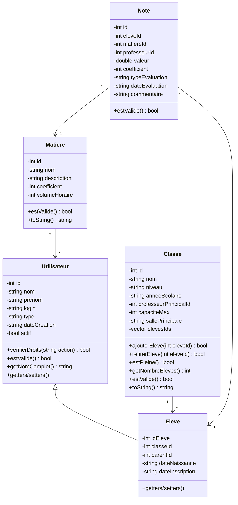
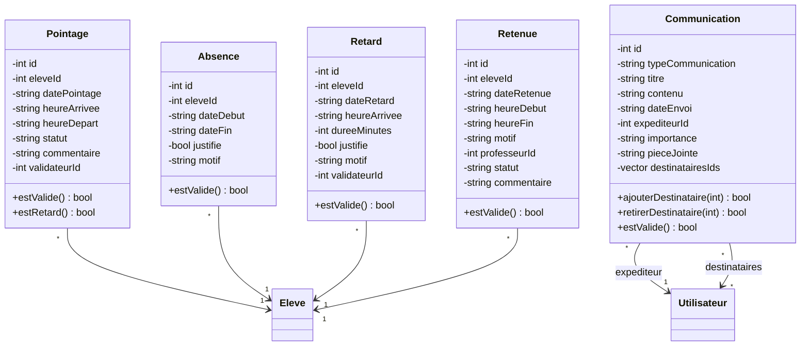
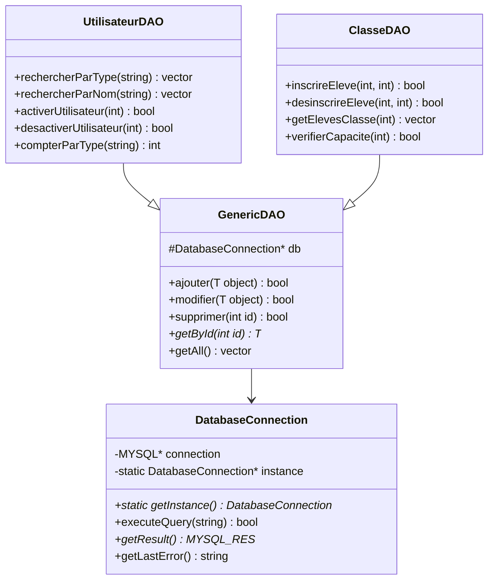

# Documentation Technique - ERP de Gestion Scolaire

## 📑 Table des matières

1. [Introduction](https://www.notion.so/Documentation-Technique-ERP-de-Gestion-Scolaire-14b95ef1091780408795cc9c0a67d328?pvs=21)
2. [Architecture du Projet](https://www.notion.so/Documentation-Technique-ERP-de-Gestion-Scolaire-14b95ef1091780408795cc9c0a67d328?pvs=21)
3. [Base de données](https://www.notion.so/Documentation-Technique-ERP-de-Gestion-Scolaire-14b95ef1091780408795cc9c0a67d328?pvs=21)
4. [Conception Orientée Objet](https://www.notion.so/Documentation-Technique-ERP-de-Gestion-Scolaire-14b95ef1091780408795cc9c0a67d328?pvs=21)
5. [Implémentation](https://www.notion.so/Documentation-Technique-ERP-de-Gestion-Scolaire-14b95ef1091780408795cc9c0a67d328?pvs=21)
6. [Interface Utilisateur](https://www.notion.so/Documentation-Technique-ERP-de-Gestion-Scolaire-14b95ef1091780408795cc9c0a67d328?pvs=21)

## Introduction

Le projet consiste en un ERP (Enterprise Resource Planning) de gestion scolaire développé pour répondre aux besoins spécifiques des écoles en milieu rural, avec une extension pour la digitalisation du système de pointage des élèves.

### Objectifs principaux

- Gestion complète des élèves, classes, professeurs et matières
- Système de pointage numérique
- Gestion des notes et évaluations
- Suivi de la vie scolaire

## Architecture

### Structure des dossiers

```
project/
├── src/
│   ├── main.cpp
│   ├── models/           # Classes métier
│   │   ├── Utilisateur.cpp
│   │   ├── Eleve.cpp
│   │   ├── Classe.cpp
│   │   ├── Matiere.cpp
│   │   ├── Note.cpp
│   │   └── Pointage.cpp
│   ├── dao/             # Couche d'accès aux données
│   │   ├── UtilisateurDAO.cpp
│   │   ├── ClasseDAO.cpp
│   │   ├── MatiereDAO.cpp
│   │   ├── NoteDAO.cpp
│   │   └── PointageDAO.cpp
│   └── databaseConnection.cpp
├── include/
│   ├── models/          # Headers des classes métier
│   ├── dao/             # Headers DAO
│   └── databaseConnection.hpp
└── docs/

```

### Patterns de conception utilisés

1. **Singleton** : Pour la connexion à la base de données
2. **DAO (Data Access Object)** : Pour l'abstraction de la couche données
3. **MVC** : Séparation des responsabilités

## Base de données

### Configuration MySQL

- `Host:` localhost
- `Port:` 3306
- `Nom de la Base de données:` “***test_ecolsystem”***
- `Utilisateur`: root

### Classes principales et leurs tables

### Table `utilisateurs`

```sql
CREATE TABLE utilisateurs (
    id_utilisateur INT PRIMARY KEY AUTO_INCREMENT,
    nom VARCHAR(50) NOT NULL,
    prenom VARCHAR(50) NOT NULL,
    login VARCHAR(50) UNIQUE NOT NULL,
    type_utilisateur ENUM('eleve', 'professeur', 'admin') NOT NULL,
    actif BOOLEAN DEFAULT TRUE
);

```

### Table `classes`

```sql
CREATE TABLE classes (
    id_classe INT PRIMARY KEY AUTO_INCREMENT,
    nom VARCHAR(50) NOT NULL,
    niveau VARCHAR(20) NOT NULL,
    annee_scolaire VARCHAR(9) NOT NULL,
    professeur_principal_id INT,
    capacite_max INT DEFAULT 35
);

```

## Conception Orientée Objet

### Principes SOLID appliqués

1. **Single Responsibility**

```cpp
// Chaque classe a une responsabilité unique
class Utilisateur {
    // Gère uniquement les informations utilisateur
};

class UtilisateurDAO {
    // Gère uniquement l'accès aux données utilisateur
};

```

1. **Open/Closed**

```cpp
// Les classes sont ouvertes à l'extension mais fermées à la modification
class Note {
    virtual bool estValide() const;
};
```

### Hiérarchie des classes







## Implémentation

### Connexion à la base de données

Le pattern Singleton est utilisé pour garantir une unique instance de connexion :

```cpp
class DatabaseConnection {
private:
    static DatabaseConnection* instance;
    DatabaseConnection();

public:
    static DatabaseConnection* getInstance();
    bool executeQuery(const std::string& query);
};

```

### Gestion des utilisateurs

La classe `UtilisateurDAO` gère toutes les opérations CRUD :

```cpp
class UtilisateurDAO {
public:
    bool ajouter(const Utilisateur& user);
    std::vector<Utilisateur> getAll();
    Utilisateur* getById(int id);
    bool modifier(const Utilisateur& user);
};

```

### Système de pointage

Le système de pointage est géré par la classe `PointageDAO` :

```cpp
class PointageDAO {
public:
    bool enregistrerArrivee(int eleveId, const std::string& heure);
    bool enregistrerDepart(int eleveId, const std::string& heure);
    std::vector<Pointage> getPointagesJour(const std::string& date);
};

```

## Interface Utilisateur

### Menu Principal

*[Capture d'écran à insérer]*

Description : Interface principale permettant l'accès aux différentes fonctionnalités :

- Gestion des utilisateurs
- Gestion des classes
- Gestion des matières
- Gestion des notes
- Système de pointage

### Gestion des Utilisateurs

*[Capture d'écran à insérer]*

Fonctionnalités :

- Création d'utilisateurs
- Modification des informations
- Activation/désactivation de comptes
- Recherche et filtrage

### Système de Pointage

*[Capture d'écran à insérer]*

Fonctionnalités :

- Enregistrement des entrées/sorties
- Consultation des retards
- Génération de rapports

---

# Architecture du Projet ECOLSYSTEM2 - Vue Simplifiée

## 1. Structure de Base

```
ECOLSYSTEM2/
├── include/  → Définitions "Quoi faire?"
├── src/      → Implémentations "Comment le faire?"
└── bin/      → Fichiers compilés

```

## 2. Les Trois Grandes Parties

### A. Les Modèles (Models)

- **Rôle** : Représentent les objets du système
- **Exemple** :
    
    ```cpp
    class Utilisateur {
        string nom;
        string prenom;
        // ...
    }
    
    ```
    
- **Utilité** : Définir la structure des données

### B. Les DAO (Data Access Objects)

- **Rôle** : Gèrent l'accès à la base de données
- **Exemple** :
    
    ```cpp
    class UtilisateurDAO {
        bool ajouter(Utilisateur u);
        Utilisateur* getById(int id);
    }
    
    ```
    
- **Utilité** : Séparer la logique de base de données du reste du code

### C. La Connexion Base de Données

- **Rôle** : Gère la connexion MySQL
- **Utilité** : Point central pour toutes les opérations de base de données

## 3. Comment ça fonctionne ?

### Exemple d'une opération typique :

```
1. L'utilisateur veut créer un compte
   ↓
2. Le modèle Utilisateur vérifie les données
   ↓
3. UtilisateurDAO prépare la requête SQL
   ↓
4. DatabaseConnection exécute la requête
   ↓
5. Le résultat remonte la chaîne

```

## 4. Avantages Principaux

1. **Organisation Claire**
    - Chaque fichier a un rôle précis
    - Facile de trouver où modifier le code
2. **Maintenance Facilitée**
    - Modification d'une partie sans toucher aux autres
    - Tests plus simples
3. **Sécurité Améliorée**
    - Validation des données à plusieurs niveaux
    - Accès contrôlé à la base de données

## 5. En Résumé

- Les **Models** définissent la structure des données
- Les **DAO** gèrent l'accès à la base de données
- La **DatabaseConnection** centralise les opérations MySQL
- Chaque partie a un rôle distinct et communique avec les autres de manière organisée

C'est comme une usine où chaque service a son rôle précis et collabore avec les autres de manière ordonnée.

---

[Rapport Technique - ERP de Gestion Scolaire (V2)](https://www.notion.so/Rapport-Technique-ERP-de-Gestion-Scolaire-V2-15595ef10917809da8f6e2cdcd818d89?pvs=21)